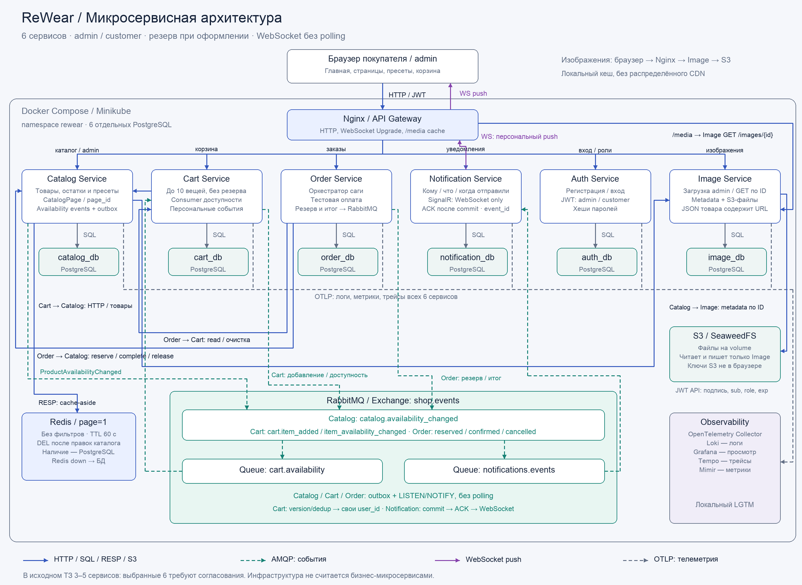

# ReWear — магазин винтажной одежды

Лабораторная №6: проектирование микросервисной архитектуры. **Шесть сервисов:** Catalog, Cart, Order, Notification, Auth и Image; своя PostgreSQL у каждого. Order — оркестратор покупки. Роли customer/admin, максимум 10 вещей, резерв только при оформлении.

**Согласование:** исходное ТЗ допускает 3–5 микросервисов. Запрошенный вариант из шести нужно согласовать с преподавателем.

## Материалы

- [Отчёт по всем пунктам ТЗ](docs/report.md).
- [Диаграмма PNG](docs/diagrams/architecture.png), [SVG](docs/diagrams/architecture.svg), [Mermaid](docs/diagrams/architecture.mmd).
- [Соответствие ТЗ](docs/compliance.md), [план реализации](docs/implementation-plan.md), [исходное задание](docs/assignment.txt).



Catalog → RabbitMQ → Cart; Cart/Order → RabbitMQ → Notification → **SignalR только WebSocket**, без SSE/Long Polling. Outbox событийный через PostgreSQL LISTEN/NOTIFY. Redis кеширует общую первую страницу. Фотографии — Image Service + локальный S3/SeaweedFS, выдача по ID через Nginx-кеш; распределённого CDN нет. Пресеты и page_id хранятся в Catalog. OpenTelemetry, Loki/Grafana и LGTM для логов, метрик и трейсов.

План запуска: Compose и Minikube на одной машине. В репозитории архитектурная работа; приложение и конфигурации запуска — следующий этап.

Повторная генерация диаграммы:

```sh
python3 -m venv .venv
.venv/bin/pip install -r scripts/requirements.txt
.venv/bin/python scripts/render_diagram.py
```
