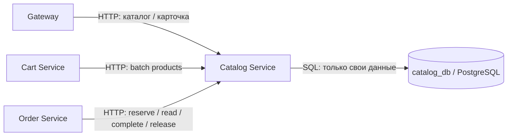
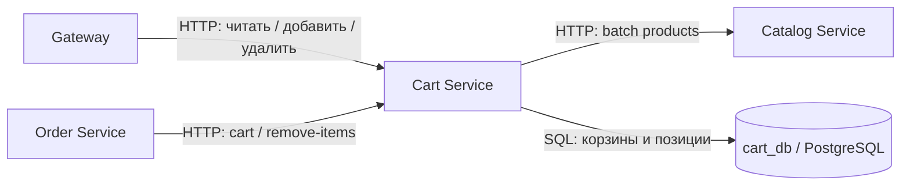
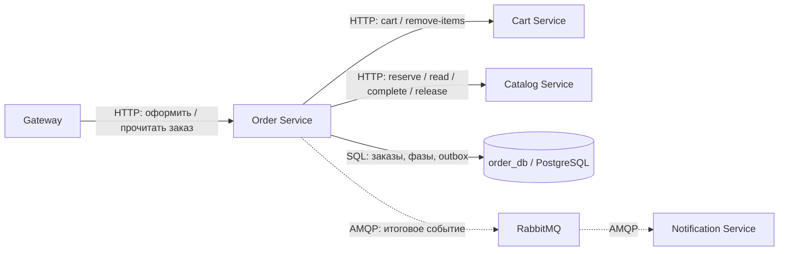
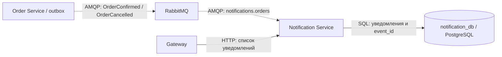

# Лабораторная работа №6
# Проектирование микросервисной архитектуры

**Проект:** ReWear — магазин винтажной одежды и ресейла  
**Тема:** E-commerce платформа  
**Студенты:** Смирнова Юлия Евгеньевна; Рыбаков Хуярик Валентинович(пися)  
**Группа:** P3369  
**Дата:** 05.11.2026

## Цель работы

Спроектировать небольшую микросервисную систему, пригодную для последующей реализации на одной машине через Docker Compose. Обосновать границы сервисов, владение данными, выбор синхронного и асинхронного взаимодействия и обработку сбоев.

ReWear — магазин одного продавца, торгующий уникальными подержанными и винтажными вещами. Каждая карточка соответствует одному физическому экземпляру. Это не площадка с кабинетами продавцов. Главный архитектурный инвариант: одна вещь может принадлежать не более чем одному подтверждённому заказу.

**Подробные разделы по сервисам:** [Catalog](#61-catalog-service) · [Cart](#62-cart-service) · [Order](#63-order-service) · [Notification](#64-notification-service).

Документ описывает проектируемую систему. Числа задержек и нагрузки ниже — целевые значения для будущей проверки, а не результаты уже проведённых измерений.

## 1. Functional Requirements

### 1.1. Пользователи и ограничения предметной области

Одна роль — покупатель. Для демонстрации используются два заранее заданных идентификатора `customer-a` и `customer-b`. Переключатель демопокупателя позволяет показать конфликт двух заказов без реализации регистрации. Это не аутентификация и не решение для публичного размещения с реальными данными.

Каталог содержит 20–30 заранее загруженных товаров. В корзине и заказе от 1 до 10 различных вещей, каждая в количестве 1; пустая корзина также допустима, но не может быть оформлена. Все цены — целые числа в копейках, валюта фиксирована: RUB. Налоговые расчёты, скидки и стоимость доставки отсутствуют. Заказы оформляются на введённые имя получателя и адрес; настоящая отправка не выполняется.

### 1.2. Основные функции — 7 требований

| ID | Функция | Поведение и критерий приёмки |
|---|---|---|
| FR-1 | Просмотр каталога | Список с пагинацией по 20 записей; фильтры по категории, размеру и цене; сортировка по цене. При отсутствии совпадений возвращается пустой список. |
| FR-2 | Карточка вещи | Название, описание, бренд, состояние, размер, цена, изображение и доступность. Неизвестный ID даёт 404. |
| FR-3 | Корзина | Добавить, удалить и просмотреть вещи. Повторное добавление не создаёт дубликат. Корзина не резервирует остаток. Недоступная вещь помечается как недоступная. |
| FR-4 | Оформление заказа | Заказ создаётся из выбранных вещей текущей корзины. Вводятся получатель и адрес. Все вещи резервируются одной атомарной операцией; частичного заказа нет. Цены берутся у Catalog, а не от клиента. |
| FR-5 | Тестовая оплата | Перед подтверждением покупатель выбирает SUCCESS или DECLINED. Успех закрепляет продажу; отказ освобождает резерв. Банковских данных нет. |
| FR-6 | Просмотр результата заказа | Экран заказа показывает позиции, зафиксированные цены, сумму, статус и причину отмены. Во время восстановления после сбоя виден статус PROCESSING. |
| FR-7 | Уведомления внутри приложения | После подтверждения или отмены заказа появляется запись в списке уведомлений покупателя. Повторная доставка события не создаёт вторую запись. Отправка email/SMS не входит в проект. |

Техническое правило FR-4: запрос оформления содержит `Idempotency-Key`. Повтор с тем же ключом и тем же содержимым возвращает тот же заказ. Тот же ключ с другим содержимым даёт 409. Ключ уникален в пределах покупателя. Это защищает от повторного заказа при двойном нажатии и повторе после тайм-аута.

### 1.3. User flow A — успешная покупка

1. Покупатель открывает каталог, выбирает фильтры и карточку вещи.
2. Добавляет одну или несколько вещей в корзину.
3. На оформлении видит текущие цены, вводит получателя и адрес, выбирает SUCCESS.
4. Клиент отправляет запрос оформления с новым ключом идемпотентности.
5. Order читает корзину у Cart и сохраняет заказ PROCESSING с неизменяемым списком выбранных ID.
6. Order запрашивает у Catalog атомарный резерв всех выбранных вещей. Catalog блокирует соответствующие строки в стабильном порядке, проверяет наличие и сохраняет резерв и снимок цен в одной транзакции.
7. Order сохраняет снимки позиций и результат тестовой оплаты. Если итоговая цена отличается от показанной клиенту, заказ отменяется с причиной PRICE_CHANGED и предлагается оформить заново.
8. При SUCCESS Order завершает резерв в Catalog: вещи становятся SOLD.
9. Order одной локальной транзакцией записывает CONFIRMED и событие в outbox. После этого безопасно удаляет из корзины только купленные позиции.
10. Покупатель видит подтверждение; событие через RabbitMQ создаёт уведомление. Непродолжительная задержка уведомления допустима.

### 1.4. User flow B — отказ оплаты

1. Покупатель собирает корзину, выбирает DECLINED и отправляет оформление.
2. Система создаёт PROCESSING и резервирует все выбранные вещи.
3. Order фиксирует результат тестовой оплаты DECLINED.
4. Order освобождает резерв через Catalog; вещи снова AVAILABLE.
5. Order сохраняет CANCELLED с причиной PAYMENT_DECLINED и событие в outbox.
6. Корзина остаётся заполненной. Покупатель видит причину отмены и затем уведомление. Для новой попытки создаётся новый заказ с новым ключом.

### 1.5. User flow C — два покупателя выбирают одну вещь

1. Покупатели A и B независимо добавляют один экземпляр в свои корзины.
2. A отправляет оформление и первым успешно резервирует вещь.
3. B отправляет оформление; транзакция Catalog обнаруживает RESERVED или SOLD у другого заказа.
4. Catalog возвращает 409 PRODUCT_UNAVAILABLE. Если у B было несколько вещей, резерв не создаётся ни для одной.
5. Заказ B отменяется с причиной PRODUCT_UNAVAILABLE, тестовая оплата не выполняется. Корзина B сохраняется, недоступная вещь отмечается.
6. Если A успешно оплачивает, только заказ A становится CONFIRMED. Если A получает отказ, вещь освобождается, и B может оформить новый заказ.

### 1.6. Out of scope

Регистрация, пароли, OAuth, роли и реальные личные кабинеты; продавцы и комиссии; административный интерфейс; загрузка пользовательских фотографий; реальные платежи, возвраты денег и банковские реквизиты; интеграция доставки, тарифы и трекинг; отмена покупателем после подтверждения; возврат и обмен вещей; отзывы, рейтинги, избранное, рекомендации, скидки и промокоды; email/SMS; резерв при добавлении в корзину; отдельный Payment Service; отдельный Inventory Service; полнотекстовый поиск; Redis, Kubernetes и облачная эксплуатация.

## 2. Non-Functional Requirements

### 2.1. Consistency model

| Данные / операция | Модель | Причина и механизм |
|---|---|---|
| Резерв уникальной вещи | Strong consistency внутри Catalog DB | Одна PostgreSQL-транзакция, блокировки строк и проверка AVAILABLE. Конкурирующие резервы одного экземпляра не могут оба завершиться успешно. |
| Резерв всех вещей заказа | Атомарность внутри Catalog DB | Все позиции резервируются вместе либо транзакция откатывается. Порядок блокировок по product_id снижает вероятность deadlock. |
| Статус заказа, результат тестовой оплаты, outbox | Strong consistency внутри Order DB | Локальные транзакции и уникальность ключа оформления. Окончательный статус записывается вместе с исходящим событием. |
| Изменение заказа и состояния вещи между БД | Eventual consistency с восстановлением | Общей транзакции нет. В промежутке вещь может быть SOLD, а заказ ещё PROCESSING. Повторяемые команды доводят заказ до результата. |
| Данные каталога, показанные в корзине | Могут устаревать | Другой покупатель может купить вещь после чтения. Только резерв подтверждает доступность и фиксирует цену. |
| Заказ и уведомление | Eventual consistency | Уведомление появляется после обработки сообщения, его задержка не меняет статус покупки. |

Strong consistency не заявляется для всей распределённой системы. Инвариант остатка обеспечивается единственным владельцем данных, а расхождения между сервисами восстанавливаются повторными командами.

### 2.2. Sync vs Async

| Связь | Тип | Причина |
|---|---|---|
| Gateway → Catalog / Cart / Order / Notification | HTTP JSON | Клиент ожидает ответ или текущие данные. |
| Cart → Catalog | HTTP JSON, пакетный запрос товаров | Корзина показывает актуальные описания и наличие без копирования каталога в свою БД. |
| Order → Cart | HTTP JSON | Получить позиции на оформлении; после успеха удалить только купленные позиции. |
| Order → Catalog | HTTP JSON | Получить результат резерва, завершения продажи или освобождения. |
| Order → RabbitMQ → Notification | События | Уведомления не должны влиять на длительность и доступность покупки. |

События передаются с гарантией at-least-once, поэтому обработчик учитывает возможные дубликаты. Гарантия exactly-once не заявляется.

### 2.3. Latency и профиль нагрузки

Цели для прогретого локального запуска: до 30 товаров, до 10 вещей в корзине, до 10 одновременных демопользователей, без внешних сетевых интеграций. Измеряем p95 от приёма HTTP-запроса gateway до ответа; задержка загрузки изображений браузером не учитывается.

| Операция | Цель p95 | Обоснование |
|---|---|---|
| Каталог и карточка | <100 мс | Частые переходы должны быстро отвечать на действия пользователя. |
| Получение / изменение корзины | <300 мс | Допускается пакетный HTTP-запрос к Catalog. |
| Оформление без сбоев | <1 с | Несколько локальных сетевых вызовов и транзакций. |
| Приём оформления при сбое | ≤3 с до ответа PROCESSING | Пользователь получает order_id вместо бесконечного ожидания. |
| Уведомление после окончательного статуса | ≤5 с при исправных компонентах | Фоновая работа может занимать больше 1 секунды. |
| Восстановление PROCESSING после возврата зависимостей | ориентир ≤30 с для малой очереди | Зависит от числа накопленных операций; во время недоступности срок не ограничен. |

### 2.4. Масштабирование и ресурсы

Catalog получает больше всего чтений; узкие места — выборки с фильтрами и конкуренция за один товар. Cart нагружается при изменениях корзины. Order получает меньше запросов, но зависит от сетевых вызовов и скорости записи. Notification можно наращивать числом обработчиков очереди.

В первой реализации — по одному экземпляру сервисов и БД. Локальная целевая конфигурация: Docker Compose, 4 CPU, 8 ГБ RAM, до 5 ГБ диска с тестовыми данными. Это бюджет для планирования, его нужно проверить при реализации. У каждого сервиса ограниченный пул соединений, например до 5 на экземпляр; каталог имеет индексы для фильтров и пагинацию.

При росте нагрузки можно добавить экземпляры HTTP-сервисов и потребителей, затем пересмотреть пулы и ресурсы PostgreSQL. Блокировка уникального товара остаётся в БД, поэтому второй экземпляр Catalog не нарушает инвариант. Order обрабатывает фоновую работу с блокировкой строки заказа; outbox — с `FOR UPDATE SKIP LOCKED`. Преждевременно добавлять кеш не требуется: для маленького каталога он усложнит инвалидирование и проверку наличия.

### 2.5. Локальное развёртывание и наблюдаемость

Docker Compose объединяет 10 контейнеров: Nginx с интерфейсом, 4 бизнес-сервиса, 4 PostgreSQL и RabbitMQ. Gateway и брокер — инфраструктура, число бизнес-микросервисов равно 4. Восстановление и публикация outbox выполняются фоновыми циклами внутри Order; отдельного микросервиса для них нет.

БД находятся во внутренней сети Compose, каждая использует отдельные учётные данные и volume. Публичный локальный порт gateway — 8080; management UI RabbitMQ, если нужен для защиты, доступен только на localhost. Потерю всех volumes эта схема не переживает; высокой доступности на одной машине нет.

Планируемые средства диагностики: `/health` у каждого сервиса, логи с request_id, order_id и event_id; healthcheck БД и RabbitMQ; ошибки зависимостей видны в логах. Реальная авторизация потребуется перед использованием персональных данных вне локальной демонстрации.

## 3. Архитектурная диаграмма


[SVG](diagrams/architecture.svg) · [Mermaid](diagrams/architecture.mmd)

Сплошная линия — синхронное взаимодействие; HTTP подписан явно. Пунктирная линия — AMQP / асинхронная доставка. Связи с БД — SQL. Nginx маршрутизирует внешние запросы и не владеет бизнес-данными.

| Сервис | Bounded context и ответственность | Хранилище |
|---|---|---|
| Catalog | Товары, атрибуты, цены, уникальные остатки и резервы | catalog_db, PostgreSQL |
| Cart | Выбранные покупателем позиции; корзина не гарантирует наличие | cart_db, PostgreSQL |
| Order | Оформление, снимки позиций, тестовая оплата, восстановление процесса и исходящие события | order_db, PostgreSQL |
| Notification | Создание и чтение уведомлений по итоговым событиям | notification_db, PostgreSQL |

Технологический план реализации: один язык и HTTP JSON для всех сервисов; рекомендуемый вариант — C# / ASP.NET Core, PostgreSQL и RabbitMQ. Версии зависимостей фиксируются на этапе реализации. Данная лабораторная не требует кода сервисов или выбора актуальных версий SDK.

## 4. Data Model и API

### 4.1. Общие правила данных

Идентификаторы — UUID, время — UTC, денежные суммы — целые копейки, валюта — RUB. Ни один сервис не подключается к чужой БД. Внешние ссылки product_id и order_id не являются межбазовыми foreign key. Имена и цены копируются в заказ как исторический снимок, а не как второе место редактирования каталога.

Ниже перечислены основные поля каждой сущности — от 3 до 7 полей. PK — первичный ключ, FK — внешний ключ внутри одной БД, UQ — уникальность.

### 4.2. Catalog DB

| Entity | Основные поля | Ограничения / связь |
|---|---|---|
| Product | id, title, category, size, price_minor, description | PK id; price_minor > 0. Категория — строка из фиксированного списка. |
| ProductDetails | product_id, brand, condition, image_url | PK/FK product_id → Product; связь 1:1. Изображение — заранее подготовленный статический файл. |
| Availability | product_id, status, reservation_order_id, updated_at | PK/FK product_id → Product; связь 1:1; status AVAILABLE / RESERVED / SOLD. |
| Reservation | order_id, state, created_at, updated_at | PK order_id; state ACTIVE / COMPLETED / RELEASED. Это технический идентификатор заказа, без FK в Order DB. |
| ReservationItem | order_id, product_id, title_snapshot, price_minor | PK (order_id, product_id); FK в Reservation и Product; снимок результата резервирования. |

AVAILABLE означает reservation_order_id = null. Для RESERVED и SOLD хранится владелец order_id. Это позволяет завершать или освобождать только собственный резерв. Reservation RELEASED сохраняется как маркер: запоздавший повтор reserve для отменённого заказа не должен заново захватить вещь.

### 4.3. Cart DB

| Entity | Основные поля | Ограничения / связь |
|---|---|---|
| Cart | id, customer_id, updated_at | PK id; UQ customer_id. |
| CartItem | id, cart_id, product_id, added_at | PK id; FK cart_id → Cart; UQ(cart_id, product_id). |

Одна корзина содержит много CartItem. Количество всегда 1 и вычисляется по правилу предметной области; отдельного редактируемого quantity нет. ID позиции нужен, чтобы очистка после покупки удалила исходную запись, но не новую запись того же товара, добавленную после оформления.

### 4.4. Order DB

| Entity | Основные поля | Ограничения / связь |
|---|---|---|
| Order | id, customer_id, status, total_minor, reason, idempotency_key, created_at | PK id; UQ(customer_id, idempotency_key). status PROCESSING / CONFIRMED / CANCELLED. |
| OrderItem | id, order_id, product_id, title_snapshot, price_minor | PK id; FK order_id → Order; UQ(order_id, product_id). |
| Checkout | order_id, selection, recipient, address, expected_total_minor, phase, request_hash | PK/FK order_id → Order; selection хранит неизменяемые product_id и cart_item_id. |
| PaymentAttempt | order_id, result, created_at | PK/FK order_id → Order, связь 1:1; result SUCCESS / DECLINED. В этой версии одна тестовая попытка на заказ. |
| OutboxEvent | event_id, order_id, event_type, payload, created_at, published_at, attempts | PK event_id; FK order_id → Order; UQ(order_id, event_type). |

Order содержит много OrderItem. Checkout и PaymentAttempt принадлежат одному Order. OutboxEvent — техническая таблица надёжной публикации. Фазы Checkout: INIT, RESERVED, FINALIZING, RELEASING, DONE, CLEANED. Значение тестового исхода сохраняется при создании заказа и не меняется восстановителем.

### 4.5. Notification DB

| Entity | Основные поля | Ограничения / связь |
|---|---|---|
| Notification | id, event_id, customer_id, order_id, type, message, created_at | PK id; UQ event_id; order_id — внешняя ссылка без межбазового FK. |

Отдельная таблица inbox не нужна: уникальность event_id в Notification одновременно защищает от повторной обработки. Прочтение уведомлений не отслеживается, поскольку эта функция не требуется MVP.

### 4.6. Владение данными

Catalog — единственный владелец каталога, цен и остатков. Cart — единственный владелец корзины. Order — владелец заказов и результата тестовой оплаты. Notification — владелец текстов уведомлений. Gateway не хранит данные. RabbitMQ переносит события, но не является источником статуса заказа.

### 4.7. Семь основных межсервисных HTTP endpoints

В примерах ниже `p1`, `c1` и `o1` — сокращения UUID ради читаемости; в реализации используются UUID. Все тела — JSON. Указанные внутренние маршруты не проксируются внешним gateway.

**1. Cart → Catalog: `GET /internal/products?ids=p1,p2`**

Тело запроса отсутствует. До 10 идентификаторов. Ответ 200:

```json
{"items":[{"id":"p1","title":"Джинсовая куртка","price_minor":450000,"status":"AVAILABLE"}],"missing_ids":["p2"]}
```

Назначение: отобразить корзину и проверить добавление вещи. Отсутствие товара передаётся явно; доступность после ответа не гарантируется.

**2. Order → Cart: `GET /internal/carts/{customer_id}`**

Тело отсутствует. Ответ 200:

```json
{"cart_id":"c1","items":[{"cart_item_id":"ci1","product_id":"p1"}]}
```

Пустая корзина возвращает items: []. Order сохраняет выбранные ID, после чего повтор оформления не перечитывает изменившуюся корзину.

**3. Order → Catalog: `POST /internal/reservations`**

Запрос:

```json
{"order_id":"o1","product_ids":["p1"]}
```

Ответ 201 при первом создании, 200 при повторе:

```json
{"order_id":"o1","state":"ACTIVE","items":[{"product_id":"p1","title":"Джинсовая куртка","price_minor":450000}],"total_minor":450000,"currency":"RUB"}
```

Вся корзина резервируется одной транзакцией. Повтор order_id с тем же набором возвращает сохранённый снимок и текущее состояние резерва; с другим набором — 409 IDEMPOTENCY_CONFLICT. Недоступная вещь даёт 409 PRODUCT_UNAVAILABLE без частичного резерва. Для RELEASED новый резерв запрещён. Пустой, повторяющийся или слишком большой список даёт 422.

**4. Order → Catalog: `GET /internal/reservations/{order_id}`**

Тело отсутствует. Ответ 200 имеет ту же структуру, что endpoint 3, и state ACTIVE / COMPLETED / RELEASED. 404 означает отсутствие записи, но после сетевого тайм-аута не доказывает, что исходный запрос не будет обработан позднее. Для отмены используется endpoint 6 с сохраняемым маркером RELEASED.

**5. Order → Catalog: `POST /internal/reservations/{order_id}/complete`**

Тело — `{}`. Ответ 200:

```json
{"order_id":"o1","state":"COMPLETED"}
```

Атомарно переводит все вещи собственного ACTIVE-резерва из RESERVED в SOLD и резерв в COMPLETED. Повтор COMPLETED успешен. RELEASED даёт 409, неизвестный order_id — 404. Нельзя завершить чужой резерв.

**6. Order → Catalog: `DELETE /internal/reservations/{order_id}`**

Тело отсутствует. Ответ 200:

```json
{"order_id":"o1","state":"RELEASED"}
```

Освобождает все вещи ACTIVE-резерва. Повтор RELEASED успешен. Для отсутствующего order_id создаёт маркер RELEASED: это блокирует запоздавший reserve. COMPLETED даёт 409, проданная вещь не освобождается. Команды одного order_id сериализуются в Catalog, например транзакционной advisory lock; дополнительно блокируются строки товаров.

**7. Order → Cart: `POST /internal/carts/{customer_id}/remove-items`**

Запрос:

```json
{"cart_item_ids":["ci1"]}
```

Ответ 200:

```json
{"removed_ids":["ci1"]}
```

Вызывается после CONFIRMED. Удаляются только переданные строки данной корзины; отсутствующие игнорируются. Повтор безопасен и возвращает пустой removed_ids. Сбой очистки не отменяет подтверждённую покупку, операция повторяется восстановителем.

### 4.8. Клиентский HTTP API через Gateway

Идентификатор демопокупателя передаётся в `X-Customer-Id` только в учебной локальной версии. Маршруты корзины, заказов и уведомлений ограничивают выборку этим покупателем. Для других покупателей не возвращается содержимое заказа. Это изоляция демоданных, а не проверка личности.

| Метод и путь | Вход | Ответ |
|---|---|---|
| GET /api/products | category, size, min_price_minor, max_price_minor, sort=price_asc/price_desc, page, page_size≤20 | 200: {items:[{id,title,price_minor,size,status,image_url}],page,total} |
| GET /api/products/{id} | ID в пути | 200: {id,title,description,category,size,brand,condition,price_minor,currency,status,image_url}; 404 |
| GET /api/cart | X-Customer-Id | 200: {items:[{cart_item_id,product_id,title,price_minor,status}],total_minor} |
| POST /api/cart/items | {product_id} | 201 при добавлении / 200 при повторе: {cart_item_id,product_id}; 404 для отсутствующего товара; 409 для недоступной вещи; 422 при превышении лимита 10 |
| DELETE /api/cart/items/{id} | ID собственной позиции | 204, в том числе при повторе |
| POST /api/orders | X-Customer-Id, Idempotency-Key; {recipient,address,expected_total_minor,payment_result} | 201: {order_id,status,total_minor,reason}; если процесс не завершён — 202 с теми же полями; 422 для пустой корзины/невалидного ввода; 409 для несовпадающего повторного ключа |
| GET /api/orders/{id} | Собственный order_id | 200: {order_id,status,reason,items:[{product_id,title,price_minor}],total_minor,currency}; 404 для отсутствующего или чужого заказа |
| GET /api/notifications | X-Customer-Id; page, page_size≤20 | 200: {items:[{id,order_id,type,message,created_at}],page,total} |

POST /api/orders создаёт ресурс даже при бизнес-отмене: терминальный CANCELLED возвращается как 201 с reason, а не как сетевой сбой. Повтор завершённого запроса возвращает 200; повтор незавершённого — 202 и тот же order_id. При 202 интерфейс опрашивает GET заказа раз в 2 секунды, пока он открыт. Пустая корзина и неверные поля отклоняются до создания заказа.

`expected_total_minor` — последняя сумма, показанная клиенту. Она проверяется против снимка Catalog; сервер не принимает её как цену. Несовпадение приводит к CANCELLED / PRICE_CHANGED с освобождением резерва. Повторный ключ связывается с хешем исходного тела, а корзина фиксируется только при первом запросе.

Единая форма ошибок: `{"error":{"code":"PRODUCT_UNAVAILABLE","message":"Одна из вещей уже недоступна","request_id":"..."}}`. Для внутренних временных сбоев используются 503/504. Бизнес-отмена заказа отражается его статусом и reason.

### 4.9. События и RabbitMQ

Durable topic exchange `orders.events`; routing keys `order.confirmed` и `order.cancelled`; durable queue `notifications.orders` с обоими bindings. Сообщения persistent, публикация с publisher confirms и проверкой маршрутизации. У издателя и потребителя разные соединения; перезапуск не требует повторного оформления заказа.

OrderConfirmed:

```json
{
  "event_id":"11111111-1111-4111-8111-111111111111",
  "event_type":"OrderConfirmed",
  "schema_version":1,
  "occurred_at":"2026-11-05T12:00:00Z",
  "order_id":"22222222-2222-4222-8222-222222222222",
  "customer_id":"customer-a",
  "total_minor":450000,
  "currency":"RUB"
}
```

OrderCancelled:

```json
{
  "event_id":"33333333-3333-4333-8333-333333333333",
  "event_type":"OrderCancelled",
  "schema_version":1,
  "occurred_at":"2026-11-05T12:05:00Z",
  "order_id":"44444444-4444-4444-8444-444444444444",
  "customer_id":"customer-b",
  "reason":"PAYMENT_DECLINED"
}
```

Издатель — только Order; получатель — Notification. Адрес и имя получателя в события не передаются, они для уведомления не нужны. У одного заказа ровно одно итоговое событие: CONFIRMED и CANCELLED — терминальные состояния. Ошибочные сообщения с неизвестной версией или неверной структурой направляются в `notifications.dead` после отклонения, без бесконечного повторения.

Order записывает событие в outbox вместе с итоговым статусом. Фоновый издатель берёт неопубликованные записи, отправляет их в RabbitMQ и только после подтверждения заполняет published_at. Сбой между публикацией и записью published_at может породить дубль. Notification вставляет запись с уникальным event_id, фиксирует транзакцию и лишь затем подтверждает сообщение через ACK. Конфликт уникальности означает уже обработанный дубль и тоже заканчивается ACK.

## 5. Trade-offs и обоснование решений

### 5.1. Почему такая декомпозиция

Каталог и остатки объединены: товар уникален, а проверка наличия и резерв должны быть атомарны. Выделение Inventory в пятую службу заставило бы синхронизировать атрибуты и состояния без достаточного выигрыша для MVP. Корзина отделена от заказа: её содержимое изменяется свободно и не является обещанием продажи. Заказ фиксирует цены и управляет завершением покупки. Уведомления отделены, поскольку их задержка не должна блокировать заказ.

Оплата — детерминированный симулятор в Order, поэтому отдельный Payment Service не нужен. Если появятся настоящий провайдер, webhooks и возвраты, его можно выделить отдельно; в эту реализацию это не входит.

Альтернатива из трёх сервисов — объединить корзину и заказ — тоже укладывается в ТЗ, но хуже показывает различие изменяемого выбора и исторического факта покупки. Вариант из пяти с отдельной оплатой увеличивает число сбоев и контрактов. Четыре сервиса — компромисс между учебной демонстрацией и объёмом реализации.

Для реального маленького магазина монолит мог бы оказаться дешевле в разработке и сопровождении. Микросервисная декомпозиция здесь выбирается в соответствии с учебным заданием и для демонстрации распределённых взаимодействий.

### 5.2. Почему HTTP и RabbitMQ

HTTP даёт результат резерва до обещания покупки. Если сделать резерв полностью асинхронным, оформление потребует дополнительных событий и более сложного ожидания результата. Для маленькой системы это лишняя сложность. Уведомления, напротив, естественно передавать через очередь: синхронный вызов сделал бы оформление зависимым от их сервиса.

RabbitMQ выбран для очереди небольших событий с ACK и повторной доставкой. Kafka для этого объёма и сценария не требуется. PostgreSQL во всех сервисах снижает число разных технологий; различные физические БД нужны для автономного владения, а не ради разнообразия хранилищ. Четыре отдельных контейнера БД наглядно показывают изоляцию, хотя один PostgreSQL с отдельными БД и пользователями мог бы потреблять меньше ресурсов.

### 5.3. Заказ как небольшой процесс с восстановлением

Это оркестрируемая сага с двумя участниками — Order и Catalog. Общая SQL-транзакция и 2PC отсутствуют. Order сохраняет шаг перед внешним действием и повторяет идемпотентную команду после сбоя. Тестовая оплата локальна, поэтому настоящих денежных компенсаций нет.

| Фаза | Действие | Следующий шаг |
|---|---|---|
| INIT | Созданы Order, Checkout, PaymentAttempt с выбранным тестовым исходом; список позиций заморожен. Выполнить reserve. | ACTIVE → RESERVED; конфликт товара → отмена после безопасного release. |
| RESERVED | Записать снимки цен и сумму. Проверить expected_total_minor и тестовый исход. | Успех → FINALIZING; отказ/смена цены → RELEASING. |
| FINALIZING | Повторять complete для того же order_id. | COMPLETED → локально CONFIRMED + outbox + DONE. |
| RELEASING | Повторять release; он создаёт RELEASED даже если reserve ещё не виден. | RELEASED → локально CANCELLED + reason + outbox + DONE. |
| DONE | Для CONFIRMED удалить исходные позиции корзины. Для CANCELLED оставить корзину. | CLEANED. |
| CLEANED | Побочных действий больше нет. | Терминальный процесс. |

Терминальное решение не меняется при восстановлении: FINALIZING не переключается на отмену из-за тайм-аута, RELEASING не выполняет complete. Тайм-аут — неизвестный исход сетевого вызова, а не отказ оплаты. Нет автоматического истечения резерва по TTL: при длительном сбое он может удерживаться, но не будет освобождён параллельно с завершением продажи. Это компромисс в пользу запрета двойной продажи. После возврата сервисов восстановитель продолжает сохранённую фазу.

Процесс восстановления выполняется внутри Order каждые 5 секунд. На один заказ допускается один активный обработчик, через блокировку в Order DB. Служебные операции Catalog сериализуются по order_id; операции разных заказов конкурируют за строки товаров. Удалённые или неизвестные товарные ID отменяют оформление, не создавая частичный резерв.

### 5.4. Отказы и решения

| Сбой | Поведение | Решение и ограничение |
|---|---|---|
| Catalog не отвечает | Корзина может показать временную ошибку; оформление остаётся PROCESSING | Тайм-аут HTTP 500 мс на попытку, ограниченный повтор, затем восстановитель. Нельзя считать товар доступным по старому ответу. |
| Потерян ответ reserve/complete | Реальное действие могло выполниться | Повтор с тем же order_id / чтение резерва. Не создавать новый заказ и не освобождать COMPLETED. |
| Order завершился после SOLD, до CONFIRMED | Вещь уже продана, заказ ещё PROCESSING | Сохранённая FINALIZING повторяет complete и записывает итог. |
| Order завершился после CONFIRMED, до публикации | Событие ещё в outbox | Издатель отправляет его после перезапуска. |
| RabbitMQ недоступен | Заказ завершается; уведомление задерживается | Outbox хранит событие, издатель повторяет с паузами 1, 2, 4, 8, затем до 30 секунд и небольшим jitter. |
| Notification недоступен | События накапливаются | Durable queue и ACK после транзакции; обработка после возврата сервиса. |
| Дубликат события | Иначе появилось бы несколько уведомлений | UQ event_id и безопасный ACK дубликата. |
| Notification DB недоступна | Сообщение не должно исчезнуть | Не ACK; приостановить потребителя с задержкой переподключения, чтобы избежать горячего цикла requeue. |
| Невалидное сообщение | Повторы не исправят структуру | Dead-letter queue, запись причины в лог; ручной разбор. |
| Cart недоступен после покупки | Заказ уже подтверждён, корзина временно содержит купленную вещь | Повтор remove-items, статус заказа не откатывается. |
| БД перегружена | Растут задержки и тайм-ауты | Ограничить пул и параллелизм, пагинация, индексы; при невозможности принять запись вернуть 503. Нельзя подтверждать незаписанную покупку. |
| Длительный сбой машины | Все компоненты недоступны | Volumes сохраняют подтверждённые записи при обычном перезапуске. Отказоустойчивый кластер и аварийное восстановление после потери диска вне объёма. |

HTTP-повторы: максимум одна дополнительная попытка после короткой задержки, только для временных ошибок и идемпотентных операций. 4xx не повторяются. После исчерпания бюджета сохранённый заказ продолжает фоновое восстановление, а клиент видит PROCESSING. Публичное создание заказа повторяется только с тем же Idempotency-Key. HTTP-обработчик ждёт завершения сохранённой операции не дольше 2 секунд, затем возвращает 202; фоновая работа продолжает процесс независимо от отключения клиента. Параллельные первые запросы с одним ключом разрешаются уникальным ограничением: проигравший обработчик читает созданный победителем заказ, а не запускает второй процесс.

Circuit breaker в первой версии не реализуется: ограниченные тайм-ауты, число попыток и параллелизм достаточны для локальной нагрузки. Если зависимость постоянно падает при росте нагрузки, breaker можно добавить для быстрого отказа и уменьшения давления на неё. Кеш также не включён в MVP; особенно нельзя использовать кеш как основание для продажи вещи.

### 5.5. Компромиссы eventual consistency и UX

Подтверждённый заказ и уведомление появляются не одновременно. Экран заказа берёт статус из Order и показывает «Уведомление может появиться позже». Пока операция восстанавливается, показывается «Заказ обрабатывается» с номером заказа. Повторное нажатие с тем же ключом открывает тот же заказ. Просмотр каталога может устареть между ответом и покупкой: конфликт доступности является ожидаемой бизнес-ситуацией.

Резерв без TTL может временно уменьшить доступный ассортимент при сбое Order. Для учебного проекта это приемлемая цена простой безопасной схемы; в будущем автоматическое освобождение потребовало бы согласования с состоянием заказа и защиты от запоздавшего complete.

## 6. Подробное описание каждого микросервиса по пунктам ТЗ

В этом разделе одна и та же структура задания применяется к каждому сервису: Functional Requirements → Non-Functional Requirements → место на архитектурной диаграмме → Data Model и API → Trade-offs. Требование «5–7 функций и 2–3 сценария» относится к системе в целом: семь функций и три пользовательских сценария уже перечислены в §1. Ниже они раскрываются через обязанности сервисов; это не добавляет новых пользовательских возможностей.

### 6.1. Catalog Service

**Назначение:** хранить сведения о винтажных вещах и определять, можно ли конкретный экземпляр зарезервировать или продать. Его bounded context — товарный каталог вместе с наличием уникальных вещей. Экземпляр сервиса имеет доступ только к `catalog_db`.

#### 6.1.1. Functional Requirements

Catalog реализует FR-1, FR-2 и часть FR-4/FR-5, связанную с наличием. Пользователь обращается к нему через gateway; Cart и Order вызывают внутренние маршруты.

| Обязанность | Что именно делает Catalog | Проверяемое правило |
|---|---|---|
| Выдать каталог | Применяет фильтры category, size, min_price_minor, max_price_minor; сортирует по цене; возвращает страницу товаров | page ≥ 1, page_size от 1 до 20; одинаковые цены дополнительно упорядочиваются по id |
| Выдать карточку | Возвращает Product, ProductDetails и актуальный Availability | Один product_id соответствует одному физическому экземпляру |
| Выдать товары пакетом | По списку ID возвращает названия, цены и наличие для корзины | Не найденные ID перечисляются в missing_ids; не выполняются десять отдельных запросов вместо одного |
| Создать резерв | Резервирует 1–10 разных вещей за одним order_id и сохраняет снимок их цен | Все позиции вместе либо ни одной; цена определяется Catalog |
| Прочитать резерв | Возвращает состояние и сохранённые позиции по order_id | Order может выяснить результат предыдущего запроса после потери ответа |
| Завершить продажу | Переводит собственный резерв ACTIVE в COMPLETED, а все его вещи в SOLD | Завершить чужой или RELEASED-резерв нельзя |
| Освободить резерв | Возвращает вещи собственного ACTIVE-резерва в AVAILABLE и сохраняет RELEASED | Повтор не влияет на чужой резерв или проданную вещь |

**Участие в пользовательских сценариях.** В сценарии A Catalog сначала показывает вещь, затем атомарно резервирует выбранные позиции и закрепляет их продажу. В сценарии B он освобождает резерв после тестового отказа. В сценарии C именно его транзакция разрешает конкуренцию двух покупателей; список вещей в корзине права на покупку не создаёт.

**Пример атомарности.** В заказе находятся куртка и рубашка. Куртка доступна, рубашку уже зарезервировали. Catalog возвращает PRODUCT_UNAVAILABLE и не оставляет куртку в RESERVED. Покупателю не создаётся частично выполненная покупка.

**За пределами сервиса:** управление продавцами, складскими партиями, количеством одинаковых экземпляров, движением поставок, ценовыми акциями, рекомендациями и CRUD-панель администратора. Начальные вещи загружаются seed-данными. Реальных пользовательских операций изменения цены или удаления товара в MVP нет; PRICE_CHANGED сохраняется как защитная проверка на случай изменения тестовых данных между чтением и резервом.

#### 6.1.2. Non-Functional Requirements

**Consistency.** Изменения Availability и Reservation выполняются одной локальной транзакцией PostgreSQL. Для команд одного order_id берётся транзакционная advisory lock, затем строки Availability блокируются в порядке product_id. После блокировки проверяется состояние всех вещей. Уровень READ COMMITTED с этими явными блокировками достаточен для рассматриваемого инварианта; простая последовательность «прочитать AVAILABLE → записать RESERVED» без блокировок недостаточна.

Чтение карточки показывает состояние на момент запроса. Оно может устареть, пока пользователь нажимает кнопку: это допустимо. Успех reserve является основанием для дальнейшей покупки. При переходе на несколько экземпляров Catalog блокировки остаются в общей для них Catalog DB.

**Sync vs Async.** Catalog принимает только синхронные HTTP-вызовы. Публичные чтения идут от gateway, пакетное чтение — от Cart, резервирование и его завершение — от Order. Собственных событий в RabbitMQ у Catalog в этой версии нет. Это упрощает контроль уникального остатка: Order получает конкретный результат операции, а не строит дополнительную цепочку событий.

**Latency.** Публичные чтения входят в цель p95 <100 мс из §2.3. Для отдельного внутреннего резервирования ориентир p95 <200 мс без конфликтов и сбоев; это часть общего бюджета оформления <1 с, а не дополнительная гарантия к нему. Долгое ожидание блокировки или недоступная БД должны завершаться временной ошибкой в пределах HTTP-бюджета, а не зависшим запросом.

**Scalability.** Это наиболее читаемый сервис. Для маленького каталога достаточно пагинации и индексов по используемым фильтрам, например `(category, size, price_minor, id)`. Набор индексов уточняется по фактическим запросам при реализации. Узкие места — сложные фильтры при росте каталога и блокировка популярной вещи при одновременных покупках. Масштабирование чтений возможно добавлением экземпляров сервиса; одна уникальная вещь всё равно резервируется последовательно. Redis не включён: кеш не должен принимать решение о наличии.

#### 6.1.3. Место на архитектурной диаграмме



На общей PNG-диаграмме Catalog расположен слева. У него нет связи с RabbitMQ, кешем или чужими БД. Gateway не проксирует клиенту `/internal/reservations`: решение о продаже принимает процесс оформления в Order.

#### 6.1.4. Data Model и API

| Сущность | Поля и типы | Ownership и связи |
|---|---|---|
| Product | id UUID, title text, category text, size text, price_minor bigint, description text | Основная карточка; PK id; положительная цена |
| ProductDetails | product_id UUID, brand text, condition text, image_url text | PK/FK product_id → Product, связь 1:1 |
| Availability | product_id UUID, status text, reservation_order_id UUID nullable, updated_at timestamptz | PK/FK product_id → Product, связь 1:1; доступность и владелец резерва |
| Reservation | order_id UUID, state text, created_at timestamptz, updated_at timestamptz | PK order_id; ссылка на Order логическая, без FK в чужую БД |
| ReservationItem | order_id UUID, product_id UUID, title_snapshot text, price_minor bigint | Составной PK; FK на Reservation и Product внутри Catalog DB; Reservation 1:N ReservationItem |

Допустимые переходы вещи: `AVAILABLE → RESERVED → SOLD` либо `AVAILABLE → RESERVED → AVAILABLE`. Проданная вещь не возвращается в продажу через release. Reservation COMPLETED и RELEASED — терминальные состояния. Вещь может последовательно участвовать в нескольких освобождённых резервах, но иметь только одного текущего владельца в Availability.

| Метод и путь | Кто вызывает | Вход | Выход |
|---|---|---|---|
| GET /api/products | Gateway | Фильтры и пагинация в query, без body | 200: страница каталога |
| GET /api/products/{id} | Gateway | product_id, без body | 200: карточка; 404 при отсутствии |
| GET /internal/products?ids=p1,p2 | Cart | До 10 ID, без body | 200: items и missing_ids |
| POST /internal/reservations | Order | order_id и product_ids | 201/200: состояние, снимки и total_minor; 409 при конфликте |
| GET /internal/reservations/{order_id} | Order | order_id, без body | 200: резерв; 404 при отсутствии |
| POST /internal/reservations/{order_id}/complete | Order | order_id и пустой объект | 200: COMPLETED; 404/409 |
| DELETE /internal/reservations/{order_id} | Order | order_id, без body | 200: RELEASED; 409 для COMPLETED |

Например, Order передаёт:

```json
{"order_id":"o1","product_ids":["p1","p2"]}
```

Успешный ответ Catalog:

```json
{
  "order_id":"o1",
  "state":"ACTIVE",
  "items":[
    {"product_id":"p1","title":"Джинсовая куртка","price_minor":450000},
    {"product_id":"p2","title":"Винтажная рубашка","price_minor":180000}
  ],
  "total_minor":630000,
  "currency":"RUB"
}
```

Для повторного order_id сравнивается набор product_ids независимо от порядка. При совпадении возвращается сохранённый снимок; при несовпадении — IDEMPOTENCY_CONFLICT. Подробные формы ответов и ошибок зафиксированы в §4.7–4.8.

#### 6.1.5. Trade-offs и обработка проблем

| Решение / проблема | Обоснование и поведение |
|---|---|
| Каталог и остатки в одной службе | Позволяет резервировать уникальные вещи и фиксировать цены одной транзакцией; отдельный Inventory увеличил бы число контрактов |
| Два заказа на один экземпляр | Блокировки и повторная проверка состояния: один заказ получает резерв, второй — бизнес-конфликт |
| Потеря ответа HTTP | Catalog не откатывает уже совершённую транзакцию из-за того, что клиент не получил ответ; Order повторяет идемпотентную команду |
| Release раньше запоздавшего reserve | Создаётся RELEASED-маркер; поздний reserve того же order_id запрещён |
| Перегрузка БД / deadlock | Ограниченное ожидание и откат транзакции; временная ошибка. Повтор выполняется с тем же order_id, без частичного изменения вещей |
| Длительный резерв | Автоматического TTL нет: после сбоя его завершает или освобождает Order. Цена решения — временно недоступная вещь |
| Недоступен RabbitMQ | На Catalog не влияет напрямую: он с broker не взаимодействует |

Критерий корректности этого сервиса: для одной вещи невозможно получить два завершённых резерва разных заказов, а неудачный резерв набора не оставляет частично занятые вещи.

### 6.2. Cart Service

**Назначение:** хранить текущий выбор покупателя. Bounded context — изменяемая корзина до оформления заказа. Её содержимое не является резервом, оплатой или историей покупки. Сервис работает только с `cart_db`.

#### 6.2.1. Functional Requirements

Cart реализует FR-3 и предоставляет Order исходные позиции для FR-4.

| Обязанность | Поведение | Проверяемое правило |
|---|---|---|
| Выдать текущую корзину | Получает собственные CartItem и пакетно дополняет их данными Catalog | Корзина покупателя определяется X-Customer-Id |
| Добавить вещь | Проверяет существование и доступность через Catalog, создаёт CartItem | Дубликат не создаётся; при повторе возвращается существующая позиция |
| Удалить вещь | Удаляет собственную позицию по cart_item_id | Повторное удаление безопасно и даёт 204 |
| Показать изменившееся наличие | При чтении использует текущее состояние Catalog | RESERVED/SOLD отображаются как недоступные, но не исчезают из корзины молча |
| Передать выбор в оформление | Внутренний endpoint возвращает cart_item_id и product_id | Не передаёт недостоверную цену как основание для продажи |
| Очистить купленные позиции | По команде Order удаляет исходные cart_item_id | Новые позиции и чужая корзина не затрагиваются |

Размер корзины ограничен 10 вещами, как и заказ. Для конкурентных добавлений проверка лимита и вставка выполняются в одной транзакции с блокировкой Cart. Количество каждой вещи всегда 1. При добавлении по уже существующему product_id сначала возвращается существующая позиция: повтор не превращается в новую покупку, даже если вещь тем временем стала недоступна.

**Участие в сценарии A:** покупатель добавляет вещи → читает корзину с актуальными данными Catalog → Order фиксирует ID позиций → после CONFIRMED Cart удаляет именно эти строки. **В сценарии B** корзина после отказа сохраняется. **В сценарии C** одинаковая вещь может находиться в разных корзинах; право на покупку определяется позднее в Catalog.

**За пределами сервиса:** резервирование остатков, фиксация цены, обработка оплаты, история заказов, промокоды, объединение гостевой и авторизованной корзины, сохранение избранного и автоматическая покупка после пополнения каталога.

#### 6.2.2. Non-Functional Requirements

**Consistency.** Внутри Cart DB состав корзины изменяется транзакционно. Уникальность `(cart_id, product_id)` защищает от дублирования при двух одновременных нажатиях. Строки из другой корзины нельзя удалить запросом по их ID. Между Cart и Catalog общей транзакции нет: вещь может стать недоступной сразу после проверки добавления. Это ожидаемая ситуация, которую окончательно разрешает резерв на оформлении.

Сумма корзины вычисляется по ценам, полученным из Catalog в этом запросе. Для RESERVED/SOLD можно показать известную цену, но оформление требует доступности всех выбранных вещей. Если product_id попал в missing_ids, в клиентском ответе для него возвращаются title и price_minor = null, status = NOT_FOUND. Для неполных данных total_minor = null: интерфейс не показывает частичный итог как полную стоимость. NOT_FOUND — вычисляемое состояние ответа Cart, не новое состояние Availability в Catalog.

**Sync vs Async.** Внешние запросы принимает от gateway. Для чтения и нового добавления вызывает Catalog по HTTP. Внутреннее чтение состава для Order и удаление строк после покупки используют только Cart DB: для них не нужен повторный запрос каталога. RabbitMQ Cart не использует. Очистка синхронная, поскольку это короткая адресная команда; её повторением при сбое занимается Order.

**Latency.** Цель p95 <300 мс для клиентских операций при исправных зависимостях. Пакетное чтение Catalog ограничивает число сетевых обращений одним на запрос корзины. Из-за сетевого тайм-аута операция может занять дольше нормальной целевой задержки — это режим сбоя. На чтение цен не подставляется произвольное старое значение ради быстрого ответа.

**Scalability.** Частые операции — чтение корзины и добавление позиций. Индексы UQ(customer_id), UQ(cart_id, product_id) и PK CartItem достаточны для основных выборок маленькой системы. Узкие места — ожидание Catalog и конкурентные изменения одной корзины. Для разных покупателей сервис можно масштабировать независимо; данные и блокировки находятся в Cart DB.

#### 6.2.3. Место на архитектурной диаграмме



Cart обращается к Catalog API, но не к Catalog DB. Order получает выбор через API Cart, а не читает его таблицы. Внешнего маршрута для полной очистки чужой корзины нет.

#### 6.2.4. Data Model и API

| Сущность | Поля и типы | Связи и ограничения |
|---|---|---|
| Cart | id UUID, customer_id text, updated_at timestamptz | PK id; UQ customer_id; один покупатель — одна корзина |
| CartItem | id UUID, cart_id UUID, product_id UUID, added_at timestamptz | PK id; FK cart_id → Cart; UQ(cart_id, product_id); Cart 1:N CartItem |

Cart владеет только наличием позиции в корзине и временем добавления. Цена, название и доступность принадлежат Catalog и в Cart DB не дублируются. product_id — логическая ссылка без FK в чужую базу.

| Метод и путь | Caller | Request | Response |
|---|---|---|---|
| GET /api/cart | Gateway | X-Customer-Id, без body | 200: items и total_minor |
| POST /api/cart/items | Gateway | X-Customer-Id, {product_id} | 201: новая позиция / 200: уже существующая; 404 для отсутствующего товара, 409 для недоступного, 422 при превышении лимита |
| DELETE /api/cart/items/{id} | Gateway | Собственный cart_item_id, без body | 204; отсутствующий или чужой ID не удаляет чужие данные |
| GET /internal/carts/{customer_id} | Order | customer_id, без body | 200: cart_id и items из идентификаторов |
| POST /internal/carts/{customer_id}/remove-items | Order | {cart_item_ids:[...]} | 200: removed_ids; повтор даёт пустой список |

Пример запроса добавления:

```json
{"product_id":"p1"}
```

Ответ 201:

```json
{"cart_item_id":"ci1","product_id":"p1"}
```

Пример клиентского чтения после обогащения данными Catalog:

```json
{
  "items":[
    {"cart_item_id":"ci1","product_id":"p1","title":"Джинсовая куртка","price_minor":450000,"status":"AVAILABLE"}
  ],
  "total_minor":450000
}
```

Order получает более короткий внутренний ответ без цены — см. §4.7. ID позиции сохраняется в Checkout.selection, чтобы безопасно очистить именно исходный состав после покупки.

#### 6.2.5. Trade-offs и обработка проблем

| Решение / проблема | Обоснование и поведение |
|---|---|
| PostgreSQL вместо Redis | Один знакомый тип БД для всех сервисов, данные не исчезают при перезапуске приложения; небольшая корзина не требует отдельной технологии |
| Товары не резервируются в корзине | Пользователь может долго выбирать, не блокируя единственный экземпляр для остальных |
| Цена получается при чтении | Нет отдельной синхронизации копии каталога; цена в корзине может поменяться до покупки и проверяется при резерве |
| Catalog недоступен | GET /api/cart или новое добавление возвращают временную ошибку; локальное удаление и внутреннее чтение ID продолжают работать при доступной Cart DB |
| Cart DB недоступна | Запись не считается успешной; возвращается 503, содержимое не заменяется пустой корзиной |
| Повтор добавления | UQ предотвращает вторую строку; возвращается ID уже существующей позиции |
| Задержка очистки после покупки | Купленная вещь временно остаётся видимой с SOLD; Order повторяет адресную очистку, статус заказа не меняется |
| Недоступен RabbitMQ | На Cart напрямую не влияет |

Circuit breaker, локальный кеш цен и собственные фоновые задачи Cart в MVP не нужны. Проверяемый результат: изменения корзины не меняют остаток, дубликаты отсутствуют, очистка одного заказа не удаляет новые или чужие позиции.

### 6.3. Order Service

**Назначение:** превратить выбор покупателя в зафиксированный результат покупки. Bounded context включает заказ, снимки его позиций, тестовую оплату и координацию оформления. Это единственный сервис, принимающий решение о статусе заказа. Ему принадлежит `order_db`.

#### 6.3.1. Functional Requirements

Order реализует FR-4, FR-5, FR-6 и создаёт основание для FR-7.

| Обязанность | Что делает Order | Бизнес-правило |
|---|---|---|
| Принять оформление | Проверяет поля, демопокупателя и Idempotency-Key, получает состав из Cart | Пустая корзина не создаёт заказ; неверное тело отклоняется до запуска процесса |
| Зафиксировать выбор | Сохраняет PROCESSING, Checkout.selection и выбранный результат симулятора | Изменение корзины после этого не меняет текущий заказ |
| Получить резерв | Вызывает Catalog с order_id и всеми product_ids | Не рассчитывает наличие по данным клиента или корзины |
| Зафиксировать цену | Сохраняет OrderItem из ответа резерва, сравнивает сумму с expected_total_minor | Цена клиента — проверка согласия с итогом, не источник суммы |
| Применить тестовую оплату | Использует сохранённый SUCCESS / DECLINED после успешного резерва и проверки цены | Не обращается к банку и не создаёт настоящего денежного списания |
| Завершить процесс | Успех: complete → CONFIRMED; отказ: release → CANCELLED | Не сообщает об успехе до фиксации продажи в Catalog |
| Выдать результат и событие | Возвращает собственный заказ; создаёт одно итоговое событие в outbox | Уведомление не является условием подтверждения покупки |

**Участие в сценарии A:** прочитать корзину → сохранить процесс → зарезервировать → проверить сумму → применить SUCCESS → завершить продажу → сохранить CONFIRMED и событие → очистить купленные позиции. **В сценарии B** DECLINED ведёт к освобождению и CANCELLED. **В сценарии C** бизнес-конфликт резерва ведёт к CANCELLED / PRODUCT_UNAVAILABLE; никакая оплата не применяется.

До успешного резерва PaymentAttempt.result обозначает выбранный тестовый исход. Сохранение этого значения в INIT само по себе не означает, что оплата уже выполнялась. Исход интерпретируется только на соответствующей фазе; при конфликте товара он остаётся неиспользованным. Это особенность симулятора, а не модель настоящего платёжного шлюза.

**За пределами сервиса:** банковская интеграция, несколько попыток оплаты одного заказа, возврат денег, изменение подтверждённого заказа, доставка и её статусы, админка, личный кабинет и список истории заказов. Пользователь просматривает результат по сохранённому order_id.

#### 6.3.2. Non-Functional Requirements

**Consistency.** В одной Order DB транзакционно создаются Order, Checkout и PaymentAttempt. Уникальность `(customer_id, idempotency_key)` допускает только один заказ на исходный запрос. Исторические OrderItem записываются из сохранённого снимка резерва, а не из нового чтения Product. Итоговый статус и OutboxEvent сохраняются одной локальной транзакцией.

Между Order DB и Catalog DB общей транзакции нет. Поэтому статус PROCESSING может некоторое время сопровождать уже завершённый резерв. Восстановление продолжает сохранённую фазу. Order не превращает технический тайм-аут в PAYMENT_DECLINED и не отменяет уже совершённую продажу из-за задержки уведомления.

**Sync vs Async.** HTTP используется для чтения состава Cart, команд резервирования Catalog, очистки Cart и выдачи заказа клиенту. Через RabbitMQ публикуются только окончательные OrderConfirmed и OrderCancelled. Восстановитель и издатель outbox работают внутри Order: они не добавляют отдельные бизнес-сервисы.

**Latency.** Нормальная цель оформления — p95 <1 с. После сохранения процесса HTTP-обработчик ожидает его завершение до 2 секунд и возвращает 202, если работа продолжается; общий ориентир ответа при сбое — не более 3 секунд с учётом приёма запроса. Если Order DB недоступна и процесс не сохранён, 202 с выдуманным order_id не возвращается: это 503. Чтение собственного сохранённого заказа ориентировано на p95 <100 мс, без обращения к Catalog или broker.

**Scalability.** Основная нагрузка — транзакции записи, внешние вызовы, восстановление и публикация outbox. Уникальный индекс ключа оформления, выборка заказов по PK и индекс неопубликованных outbox-записей поддерживают основные операции. В первой версии один экземпляр Order; при нескольких фоновые обработчики должны захватывать работу через блокировки БД, а publisher — брать outbox с SKIP LOCKED. Одновременные команды одного заказа не запускаются в разных фазах. Длительные HTTP-вызовы не должны держать общую транзакцию создания заказа открытой.

#### 6.3.3. Место на архитектурной диаграмме



Order — оркестратор оформления, но не получает прямого доступа к остаткам или корзинам в чужих БД. Ответ клиенту зависит от сохранённого результата покупки, а не от доступности Notification.

#### 6.3.4. Data Model и API

| Сущность | Поля и типы | Связи и ограничения |
|---|---|---|
| Order | id UUID, customer_id text, status text, total_minor bigint nullable, reason text nullable, idempotency_key text, created_at timestamptz | PK id; UQ(customer_id, idempotency_key); источник статуса заказа |
| OrderItem | id UUID, order_id UUID, product_id UUID, title_snapshot text, price_minor bigint | PK id; FK order_id → Order; UQ(order_id, product_id); Order 1:N OrderItem |
| Checkout | order_id UUID, selection jsonb, recipient text, address text, expected_total_minor bigint, phase text, request_hash text | PK/FK order_id → Order, связь 1:1; сохранённый процесс оформления |
| PaymentAttempt | order_id UUID, result text, created_at timestamptz | PK/FK order_id → Order, связь 1:1; детерминированный тестовый исход |
| OutboxEvent | event_id UUID, order_id UUID, event_type text, payload jsonb, created_at timestamptz, published_at timestamptz nullable, attempts integer | PK event_id; FK order_id → Order; UQ(order_id, event_type); Order 1:N OutboxEvent |

Пока снимок резерва не получен, total_minor может быть null, а items — пустым списком. Например, отмена из-за недоступной вещи не обязана иметь подтверждённую сумму. После получения снимка total_minor равен сумме OrderItem.price_minor. Currency вычисляется как RUB — отдельной колонки для неизменяемой валюты нет. reason для CONFIRMED равно null; для отмены — PRODUCT_UNAVAILABLE, PRICE_CHANGED или PAYMENT_DECLINED.

**Входящий API:**

| Метод и путь | Caller | Вход | Выход |
|---|---|---|---|
| POST /api/orders | Gateway | X-Customer-Id, Idempotency-Key, тело оформления | Новый терминальный заказ — 201; сохранённый PROCESSING — 202; повтор терминального — 200 |
| GET /api/orders/{id} | Gateway | X-Customer-Id и order_id, без body | 200: собственный заказ; 404 для отсутствующего или чужого |

Пример заголовков: `X-Customer-Id: customer-a`, `Idempotency-Key: checkout-demo-001`. Тело:

```json
{
  "recipient":"Демопокупатель",
  "address":"Тестовый адрес доставки",
  "expected_total_minor":450000,
  "payment_result":"SUCCESS"
}
```

Ответ 201 после успешного завершения:

```json
{"order_id":"o1","status":"CONFIRMED","total_minor":450000,"reason":null}
```

Ответ 202 при незавершённой операции до получения цен:

```json
{"order_id":"o1","status":"PROCESSING","total_minor":null,"reason":null}
```

При повторе ключа сначала ищется сохранённый заказ и сравнивается request_hash исходного тела. Для такого повтора не требуется доступность Cart или повторное чтение изменившейся корзины. Новый ключ означает новую попытку оформления. Один и тот же ключ с другим адресом, суммой или тестовым исходом даёт 409.

**Исходящие HTTP-вызовы:** GET внутренней корзины, POST её remove-items и четыре операции Catalog с резервом из §4.7. **Исходящие события:** OrderConfirmed и OrderCancelled с payload из §4.9. Полный адрес и получатель остаются внутри Order DB и не передаются в событии.

Публичные состояния: `PROCESSING → CONFIRMED` или `PROCESSING → CANCELLED`; оба конечных состояния неизменяемы. Внутренние фазы INIT → RESERVED → FINALIZING/RELEASING → DONE → CLEANED описывают прогресс работы, а не новые пользовательские статусы. При конфликте резервирования допускается прямой переход INIT → RELEASING с причиной PRODUCT_UNAVAILABLE.

#### 6.3.5. Trade-offs и обработка проблем

| Решение / проблема | Обоснование и поведение |
|---|---|
| Оплата находится в Order | Симулятор не имеет собственного жизненного цикла внешнего провайдера; отдельный сервис добавил бы инфраструктуру без нужной функциональности |
| Оркестрируемая сага | Одно место хранит текущую фазу; компенсация отказа — release резерва. 2PC и распределённый commit не используются |
| Ошибка до создания Order | Возвращается 422 либо 503 в зависимости от причины; нет сохранённого процесса — нет обещания фонового выполнения |
| Ошибка после создания Order | Сохранённый заказ остаётся PROCESSING, восстановитель продолжает фазу после возврата зависимостей |
| Ответ complete потерян | FINALIZING повторяет complete для того же order_id; не запускает противоположный release |
| RabbitMQ недоступен | CONFIRMED/CANCELLED и событие уже сохранены вместе. Publisher ждёт восстановления broker, покупка не откатывается |
| Crash между публикацией и published_at | Возможен дубль события; тот же event_id сохраняется при повторной отправке |
| Cart недоступен после покупки | Статус остаётся CONFIRMED, удаление исходных строк повторяется позднее |
| Outbox растёт при долгом сбое | События не удаляются ради уменьшения очереди; при исчерпании диска новые транзакции не объявляются успешными |

Retry ограничен правилами §5.4: одна дополнительная HTTP-попытка для временных ошибок и безопасных команд; затем фоновые повторы. У outbox отдельное ожидание с backoff. Circuit breaker и кеш в первой реализации отсутствуют. Принцип fallback: показать известный PROCESSING, а не придумывать окончательный результат при неопределённом исходе.

Критерий корректности: один ключ оформления создаёт один заказ; CONFIRMED означает закреплённую за ним продажу всех вещей; CANCELLED появляется после безопасного освобождения; терминальный статус и итоговое событие не расходятся из-за сбоя локальной записи.

### 6.4. Notification Service

**Назначение:** преобразовывать итоговые события заказа в понятные покупателю уведомления и выдавать их список. Bounded context — уведомления, а не управление заказом. Сервис владеет только `notification_db`.

#### 6.4.1. Functional Requirements

Notification реализует FR-7. Он не участвует в принятии решения об оплате или доступности вещи.

| Обязанность | Поведение | Проверяемое правило |
|---|---|---|
| Принять итоговое событие | Читает OrderConfirmed и OrderCancelled из своей очереди | Обрабатывает schema_version = 1 и известные типы |
| Сформировать текст | Использует type, order_id, total_minor или reason | Например: «Заказ o1 подтверждён» либо «Заказ o2 отменён: оплата отклонена» |
| Сохранить уведомление | Записывает одну строку с event_id | ACK отправляется только после commit |
| Обработать повтор | Проверяет уникальность event_id | Дубль не создаёт вторую строку и завершается ACK |
| Выдать список | Фильтрует по демопокупателю, возвращает страницы | Уведомления другого customer_id не попадают в ответ |

Это внутренние обязанности одной пользовательской функции, а не пять новых функций приложения. Количество основных функций системы остаётся семь.

**Участие в сценарии A:** Order сохраняет CONFIRMED и outbox → publisher отправляет событие → Notification принимает его → создаёт запись → покупатель открывает список и видит подтверждение. **В сценарии B** аналогично создаётся сообщение об отказе оплаты. **В сценарии C** покупатель B получает сообщение о недоступной вещи, а A — свой отдельный результат оформления.

**За пределами сервиса:** email, SMS, push, WebSocket, отметка «прочитано», удаление уведомлений, пользовательские шаблоны, настройки каналов и расписание рассылок. Для MVP достаточно обычного HTTP-чтения списка; фоновые сообщения поступают через broker независимо от того, открыт ли экран покупателя.

#### 6.4.2. Non-Functional Requirements

**Consistency.** Уведомления согласуются с заказом eventually: заказ уже завершён, но сообщение ещё может стоять в очереди. Внутри Notification DB вставка записи транзакционна, а UQ(event_id) обеспечивает один сохранённый результат обработки события. Это не exactly-once доставка: брокер вправе доставить дубль, но повтор не создаёт второй эффект в таблице.

Notification не проверяет статус заказа по HTTP у Order: доверяет корректно опубликованному итоговому событию. Это снижает связанность и позволяет обработать очередь, даже когда Order временно недоступен. В данной модели заказ имеет только одно итоговое событие, поэтому не требуется согласовывать череду противоречащих изменений статуса.

**Sync vs Async.** Вход от RabbitMQ — асинхронный AMQP. Чтение списка через gateway — синхронный HTTP. Исходящих межсервисных HTTP-вызовов у Notification нет. Ошибка уведомления не должна превращаться в ошибку оформления заказа.

**Latency.** Нормальная цель — запись уведомления не позднее 5 секунд после фиксации итогового статуса Order при исправных компонентах; это весь путь outbox → RabbitMQ → consumer → DB, а не только время одной вставки. Чтение страницы списка ориентировано на p95 <100 мс. При недоступном broker или БД задержка может быть больше и заранее не ограничена.

**Scalability.** Нагрузка примерно соответствует числу завершённых заказов. Узкие места — скорость потребителя, вставки и рост очереди при сбое. В первой версии один consumer и небольшой ограниченный prefetch, например 10. При росте можно добавить конкурирующих потребителей той же очереди; уникальность event_id остаётся в БД. Для чтения нужен индекс `(customer_id, created_at, id)` и пагинация. Список сортируется по времени создания записи и id; это порядок сохранённых уведомлений, а не гарантия глобального порядка событий брокера.

#### 6.4.3. Место на архитектурной диаграмме



RabbitMQ — инфраструктурный посредник. Список уведомлений читается из Notification DB, поэтому уже сохранённые уведомления доступны даже при остановленном broker, если сам сервис и его БД работают.

#### 6.4.4. Data Model и API

| Сущность | Поля и типы | Связи и ограничения |
|---|---|---|
| Notification | id UUID, event_id UUID, customer_id text, order_id UUID, type text, message text, created_at timestamptz | PK id, UQ event_id. Внешний order_id без FK в Order DB. Других таблиц и внутренних связей в MVP нет |

Notification владеет текстом и временем создания уведомления. Статус заказа берётся из события только для построения текста; таблица не становится альтернативным хранилищем жизненного цикла заказа. Полное событие с адресом не сохраняется и не нужно.

**Единственный пользовательский endpoint:** `GET /api/notifications?page=1&page_size=20`. Caller — Gateway; заголовок X-Customer-Id обязателен для выбора демопокупателя; body отсутствует. Ответ 200:

```json
{
  "items":[
    {
      "id":"n1",
      "order_id":"o1",
      "type":"OrderConfirmed",
      "message":"Заказ o1 подтверждён",
      "created_at":"2026-11-05T12:00:02Z"
    }
  ],
  "page":1,
  "total":1
}
```

Пустой список — обычный 200, а не ошибка. Неверные параметры страницы дают 422; недоступность Notification DB — 503. На клиенте при ошибке не показывается сообщение «уведомлений нет», потому что это неизвестный результат чтения.

**Входной событийный контракт:** exchange `orders.events`, queue `notifications.orders`, bindings `order.confirmed` и `order.cancelled`. Publisher — Order. Для обоих событий обязательны event_id, event_type, schema_version, occurred_at, order_id, customer_id. Для подтверждения дополнительно total_minor и currency, для отмены — reason. Примеры полных payload приведены в §4.9.

Алгоритм обработки одного сообщения:

1. Проверить структуру, версию и соответствие типа ожидаемому routing key.
2. Сформировать текст по фиксированному шаблону и причине.
3. В транзакции вставить Notification с event_id и зафиксировать изменения.
4. Отправить ACK. Если event_id уже существует, не создавать новую запись и тоже отправить ACK.
5. При временной ошибке БД не подтверждать сообщение; приостановить обработку и восстановить соединение с паузой. При необрабатываемой структуре направить сообщение в dead-letter queue.

#### 6.4.5. Trade-offs и обработка проблем

| Решение / проблема | Обоснование и поведение |
|---|---|
| Отдельный Notification Service | Позволяет задерживать и повторять фоновую работу без блокировки оформления; его падение не отменяет покупку |
| Уведомления только в приложении | Для демонстрации асинхронной обработки не требуются почтовые credentials, внешний провайдер и доставки email |
| Нет отдельной inbox-таблицы | Уникальный event_id в единственной таблице уже защищает её единственный побочный эффект — вставку уведомления |
| Consumer завершился до commit | ACK ещё не отправлен; сообщение будет доставлено повторно |
| Consumer завершился после commit, до ACK | Повтор упрётся в UQ(event_id); вторая запись не появится |
| Broker недоступен | Приём новых событий остановлен, Order сохраняет их в outbox; чтение уже сохранённых уведомлений продолжается |
| Notification DB недоступна | Сообщение не подтверждается; не возникает бесконечного горячего цикла немедленных requeue |
| Событие повреждено / версия неизвестна | Dead-letter queue `notifications.dead` и лог с причиной; окончательный статус заказа не меняется |

Невалидные события обрабатываются отдельно от временных ошибок: ожидание восстановления БД может помочь, а повтор того же повреждённого JSON его не исправит. Ручной разбор dead-letter queue — эксплуатационная процедура при демонстрации сбоев, пользовательский интерфейс для неё не реализуется.

Критерий корректности: каждый корректный итоговый event_id после восстановления зависимостей приводит к одной записи нужного покупателя; повторная доставка и задержка не меняют заказ и не создают лишних уведомлений.


## 7. Материалы и выполнение условий

Основной документ — этот Markdown-файл. Архитектурная диаграмма приложена как PNG и встроена выше. Источники SVG и Mermaid позволяют изменять схему. [Матрица соответствия ТЗ](compliance.md) сопоставляет каждый пункт задания с разделом работы. [План реализации](implementation-plan.md) фиксирует объём следующего этапа без новых пользовательских функций.

В текущую лабораторную входит проектирование. Код сервисов, рабочий Docker Compose и измерения производительности выполняются на этапе реализации и не выдаются в этой работе за готовые результаты.
