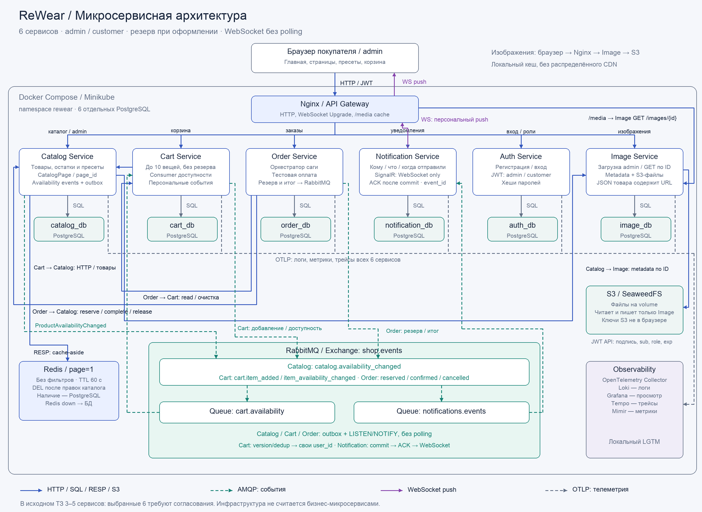

# Лабораторная работа №6: проектирование микросервисной архитектуры

**Проект:** ReWear — магазин винтажной одежды и ресейла  
**Тема:** E-commerce платформа  
**Студенты:** Смирнова Юлия Евгеньевна; Рыбаков Хуярик Валентинович(пися)  
**Группа:** P3369  
**Дата:** 06.11.2026

**Цель:** спроектировать систему из шести микросервисов для последующей реализации на одной машине. Каждая вещь существует в одном экземпляре; главная гарантия — отсутствие двойной продажи. Резерв возникает только при оформлении. Стек: C# / ASP.NET Core, PostgreSQL, RabbitMQ, Redis, SignalR/WebSocket, S3-совместимое хранилище и OpenTelemetry/Grafana/Loki.

**Отклонение от исходного ТЗ:** в присланном задании разрешены 3–5 микросервисов. По последним правкам выбран вариант с шестью, включая Image Service. Это требует согласования с преподавателем; соответствие ограничению по количеству не заявляется.

## 1. Functional Requirements

### 1.1. Семь основных функций

| ID | Функция | Критерий выполнения |
|---|---|---|
| FR-1 | Учётные записи и права | Регистрация, вход/выход; роли customer и admin; покупатель видит только свои данные |
| FR-2 | Главная и каталог | Визуальная главная с пресетами «Куртки», «Рубашки», «Размер M», «До 3 000 ₽»; каталог с фильтрами, сортировкой и карточками; страницы до 20 товаров; готовые пресеты хранятся в Catalog и связаны с page_id |
| FR-3 | Управление товарами | Admin создаёт и редактирует доступные вещи, цену и фотографию; изменение зарезервированной/проданной вещи запрещено |
| FR-4 | Корзина | До 10 уникальных вещей, количество каждой 1; добавить/удалить/прочитать; CartItemAdded через RabbitMQ; добавление не резервирует товар; события Catalog обновляют доступность и уведомляют владельцев затронутых корзин |
| FR-5 | Оформление и тестовая оплата | Получатель и адрес; атомарный резерв всех вещей; SUCCESS закрепляет продажу, DECLINED освобождает резерв |
| FR-6 | Результат заказа | Позиции, снимки цен, сумма, PROCESSING / CONFIRMED / CANCELLED и причина; обновление по push-событию без периодических HTTP-запросов |
| FR-7 | История и push-уведомления | Кому, что и когда отправляли; сообщения о добавлении, резерве и результате заказа; SignalR только WebSocket, дедупликация и восстановление после разрыва |

Демонстрация: 20–30 товаров, два зарегистрированных покупателя и один начальный admin. Все суммы — целые копейки, валюта RUB. Каталог публичен; корзина, заказ и уведомления требуют входа. Admin дополнительно управляет каталогом, но не получает доступ к чужим покупкам. Тестовая оплата остаётся внутри Order.

### 1.2. Три пользовательских сценария

**A. Покупка:** зарегистрироваться/войти → открыть главную и пресет → карточка → добавить в корзину → получить «Товар добавлен» → оформить с SUCCESS → Order создаёт PROCESSING → Catalog резервирует весь набор → событие OrderReserved → Catalog закрепляет SOLD → Order сохраняет CONFIRMED → WebSocket сообщает результат → купленные позиции удаляются из корзины.

**B. Отказ и конфликт:** покупатель оформляет с DECLINED → после резерва Order освобождает вещи → CANCELLED / PAYMENT_DECLINED, корзина остаётся, приходит уведомление. Если ту же вещь раньше зарезервировал другой заказ, весь резерв отклоняется без частичных изменений; причина PRODUCT_UNAVAILABLE, оплата не применяется. Новая попытка — новый заказ.

**C. Работа admin:** войти начальной учётной записью → создать товар → загрузить JPEG/PNG/WebP → Image Service сохраняет файл в S3 и metadata в image_db; Catalog получает image_id и возвращает image_url в JSON → товар появляется в каталоге. При редактировании доступного товара меняются данные БД и инвалидируется кеш первой страницы. Customer получает 403 на административных маршрутах.

### 1.3. Out of scope

Маркетплейс и комиссии, соцвход, MFA, сброс пароля, refresh-токены, смена ролей через интерфейс, удаление пользователей, полноценный профиль, удаление товаров, резерв в корзине, реальные платежи/возвраты/доставка, отзывы, избранное, рекомендации, скидки, email/SMS, автоматическая обработка фотографий. Payment остаётся внутри Order. Распределённый CDN, облачные аккаунты, Helm, автоскейлинг и высокодоступный кластер не входят в реализацию. Nginx даёт локальный кеш изображений, не распределённую CDN.

## 2. Non-Functional Requirements

### 2.1. Consistency

| Данные | Модель и механизм | Обоснование |
|---|---|---|
| Пользователь/роль | Strong consistency в Auth DB, уникальный email | Регистрация не создаёт дубликаты; роли не задаются клиентом |
| Резерв и изменение товара admin | Strong consistency в Catalog DB, транзакции и блокировки Availability | Нельзя продать экземпляр дважды или изменить его во время резерва |
| Остаток и событие Catalog | Одна транзакция Availability + версия + Catalog outbox | Cart узнаёт об изменении только после фиксации реального состояния |
| Корзина и её событие | Одна транзакция CartItem + Cart outbox | Добавление и основание уведомления не расходятся |
| Заказ, фаза и его событие | Одна транзакция Order DB + outbox | Сохранённый шаг можно безопасно продолжить |
| Order ↔ Catalog | Eventual consistency, сохраняемая сага | Общего commit между БД нет; временно возможен PROCESSING при SOLD |
| Каталог ↔ кеш | Eventual consistency до TTL 60 с | Кеш только для показа; наличие и цена покупки — PostgreSQL |
| Покупка ↔ уведомление | Eventual consistency, at-least-once и UQ event_id | Push может задержаться; дубли доставки не создают вторую запись |

### 2.2. Sync vs Async

| Связь | Способ | Причина |
|---|---|---|
| Gateway → шесть сервисов | HTTP JSON | Запросы клиента и результат действий |
| Cart → Catalog; Order → Cart/Catalog | HTTP | Нужны данные корзины и определённый результат резерва |
| Catalog → RabbitMQ → Cart; Cart / Order → RabbitMQ → Notification | AMQP push | Уведомления не блокируют покупку |
| Notification ↔ браузер через Gateway | SignalR, только WebSocket | Push и подтверждение курсора без polling и без SSE |
| Catalog → Redis / Image; Image → S3 | RESP / HTTP / S3 API | Кеш страницы / проверка изображения / хранение файлов |
| Шесть сервисов → OTel Collector | OTLP push | Связанные логи, метрики и трейсы |

### 2.3. Latency и масштабирование

Целевые p95 для прогретого локального запуска: до 30 товаров, 10 вещей в корзине и 10 одновременных пользователей. Это цели будущей проверки, не выполненные измерения.

| Операция | Цель | Причина |
|---|---|---|
| Каталог, карточка, чтение заказа/истории | <100 мс | Частые чтения |
| Вход/регистрация | <1 с | Включают вычисление хеша пароля |
| Корзина | <300 мс | Один пакетный вызов Catalog |
| Оформление | <1 с без сбоев; ≤3 с до 202 при сохранённом PROCESSING | Пользователь получает order_id, затем push результата |
| Уведомление | ≤5 с при исправных компонентах | Фоновая цепочка может занимать >1 с |
| Восстановление заказа | Ориентир ≤30 с после возврата зависимостей при малой очереди | Во время сбоя срок не ограничен |

Больше всего чтений у Catalog: пагинация, индексы фильтров и Redis. Image нагружен выдачей файлов (Nginx снимает повторные чтения); Auth ограничивает нагрузку на хеширование; Order зависит от записей и внешних команд; Notification — от очереди, записи истории и WebSocket-подключений. Первая версия — по одной реплике. HTTP-сервисы можно размножать; блокировки уникальных вещей остаются в БД. Для нескольких Notification потребуется распределённая доставка подключённым клиентам; backplane не входит в первую версию. Пулы БД ограничены, например пятью соединениями на экземпляр плюс выделенное LISTEN-соединение там, где нужно.

### 2.4. Compose и Kubernetes

Одни образы: Compose для разработки, одноузловой Minikube для демонстрации, одновременно не требуются. Плановый бюджет полной локальной схемы — 6 CPU, 12 ГБ RAM, 30 ГБ свободного диска; его проверим на реализации.

| Объект namespace `rewear` | Назначение |
|---|---|
| 8 Deployment | Шесть бизнес-сервисов, Nginx и Redis; по одной реплике |
| 9 StatefulSet и 9 PVC | Шесть PostgreSQL, RabbitMQ, локальное S3-хранилище, демонстрационный observability-backend |
| Service | ClusterIP для внутренних соединений; headless Service для StatefulSet |
| ConfigMap / Secret | Настройки/публичный JWT-ключ; пароли БД, private key Auth, сервисные/S3 credentials |
| Probes / ресурсы | Startup, readiness, liveness, CPU/RAM requests и limits |
| Локальный доступ | Port-forward к Nginx и отдельно к Grafana; Nginx проксирует WebSocket Upgrade |

Итого 17 прикладных Pod плюс системные компоненты Minikube. Redis — без persistence/PVC, maxmemory 64 МБ и limit 128 MiB, allkeys-lru. Readiness бизнес-сервиса учитывает свою БД, liveness — процесс; отказ Redis/broker не вызывает каскадный рестарт. Миграции — до готовности единственной реплики. PVC переживает обычное пересоздание Pod, но не гарантирует сохранность при потере диска/кластера. Высокой доступности одной машины нет.

### 2.5. Авторизация и роли

Auth хранит пользователей и хеши паролей, использует стандартный PasswordHasher, а не собственную криптографию. Регистрация всегда создаёт customer; поле role от клиента не принимается. Начальный admin создаётся bootstrap-командой с паролем из Secret. Уникальность нормализованного email — в БД; после пяти неверных входов учётная запись блокируется на 15 минут, ответ не раскрывает наличие email.

JWT для закрытого учебного приложения: RS256, sub=user UUID, role, iss, aud, exp; срок 15 минут. Private key есть только у Auth, API проверяют подпись публичным ключом, issuer, audience, срок и sub локально. Пример реализации — [JWT bearer в ASP.NET Core](https://learn.microsoft.com/en-us/aspnet/core/security/authentication/configure-jwt-bearer-authentication). Клиент хранит токен только в памяти; выход удаляет его и закрывает WS, ранее выданный токен остаётся действителен до exp. Мгновенного отзыва/refresh нет.

Customer и admin работают только со своей корзиной/покупками; Catalog дополнительно требует admin для записи. Пользователь определяется из проверенного sub, клиентский X-Customer-Id не используется. Без токена — 401, без роли — 403, чужой заказ — 404. Внутренние API не доступны через Gateway и проверяют X-Service-Key: отдельные ключи Cart/Order/Catalog с разрешёнными маршрутами. Поэтому восстановление заказа не зависит от истёкшего пользовательского JWT. Ключи — в Secret, не в Git.

### 2.6. Кеш первой страницы и изображения

Redis cache-aside хранит **только общую первую страницу без фильтров**, page_size=20 и сортировка price_asc с id для равных цен. Ключ `rewear:catalog:first-page:v1`, TTL 60 с; копируются описания/цены для показа, порядок и total. Наличие подмешивается одним чтением Availability из PostgreSQL. Другие страницы, карточки и пресеты читаются из БД. После admin create/update/image выполняется DEL после commit; при сбое/гонке допустима старая копия до TTL. Reserve/complete/release и цена покупки всегда используют БД. При отказе Redis — fallback, бюджет кеша 30 мс без повторов.

**Пресеты:** Catalog хранит CatalogPage(id, slug, title) и SearchPreset(id, page_id, title, filters, sort, position). Главная получает наборы по page_id/slug, каталог выполняет сохранённые фильтры по preset_id. Это не статический список во frontend и не отдельный сервис. Начальные страницы/пресеты — seed; редактор пресетов вне MVP. При preset_id используются его фильтры/сортировка и заданная пагинация, конфликтующие ручные фильтры дают 422. page_id задаёт контекст страницы и проверяет принадлежность preset_id; без пресета/ручных фильтров показывается общий каталог. Кешируется только общая первая страница, не все первые страницы пресетов.

**Изображения:** отдельный Image Service владеет image_db и S3-объектами. Admin загружает один JPEG/PNG/WebP до 5 МБ; сервис проверяет формат и сохраняет файл с неизменяемым ключом в локальном S3-совместимом [SeaweedFS](https://github.com/seaweedfs/seaweedfs), metadata — в своей БД. При ошибке записи metadata новый объект удаляется по возможности, незавершённое изображение не выдаётся как READY. Catalog хранит только image_id и проверяет READY через API Image. Привязка к RESERVED/SOLD запрещена; неиспользованные загрузки не меняют товар.

В JSON товара возвращается image_url=`/media/images/{image_id}`. Путь байтов: **браузер → Nginx (кеш) → Image Service GET /images/{id} → S3**. В ответе Content-Type, ETag и Cache-Control; новая фотография получает новый ID/URL. При miss Nginx обращается к Image, при hit отдаёт файл из кеша. S3 credentials есть только у Image, прямого доступа браузера к S3 нет. Это локальная альтернатива варианту «браузер → CloudFront → S3»; настоящий CloudFront/распределённый CDN не разворачивается. Пароли и изображения не передаются через WebSocket.

### 2.7. Observability

Сервисы отправляют OTLP в локальный OpenTelemetry Collector; **Loki хранит логи, Grafana показывает данные**, Tempo — трейсы, Mimir — метрики. Для небольшой демонстрации используем единую сборку [grafana/otel-lgtm](https://grafana.com/docs/opentelemetry/docker-lgtm/), а не пять отдельно настраиваемых кластеров.

Отслеживаем HTTP p95/ошибки, входы без раскрытия credentials, reserve conflicts, исходы заказов, cache hit/miss, задержку outbox/уведомлений и число WS-подключений. traceparent передаётся через HTTP и RabbitMQ headers; логи содержат trace_id, order_id, event_id. В Grafana по заказу можно связать Cart/Order/Catalog и обработку его события. Базовый профиль собирает телеметрию приложения; полный набор exporters для всех инфраструктурных систем не обещается. Пароли, JWT, query access_token и адреса доставки не логируются. Недоступность telemetry-backend не блокирует покупки.

## 3. Архитектурная диаграмма и сервисы



[SVG](diagrams/architecture.svg) · [Mermaid](diagrams/architecture.mmd). Сплошные линии — запросы HTTP/SQL/RESP/S3/WS, пунктир — AMQP; серая связь OTLP — телеметрия. Инфраструктура не увеличивает число бизнес-сервисов.

| Сервис / bounded context | Функции и сценарии | Данные, взаимодействия и требования | Решения / границы |
|---|---|---|---|
| Catalog — товар, пресеты и остаток | FR-2/3/5: каталог, страницы/пресеты, admin и резерв | catalog_db + outbox, Redis, HTTP к Image; публикует ProductAvailabilityChanged | Admin меняет только AVAILABLE; файлами владеет Image |
| Cart — изменяемый выбор | FR-4: максимум 10; CartItemAdded в A; B сохраняет выбор | cart_db + свой outbox; HTTP к Catalog, AMQP consumer изменений наличия и publisher персональных событий | Добавление не резервирует; повторы не создают вторую строку/событие |
| Order — оформление и сага | FR-5/6: оркестрирует A/B, публикует резерв и итог | order_db + outbox; HTTP к Cart/Catalog, AMQP; локальная атомарность, между БД eventual | Тестовая оплата внутри, без отдельного Payment; терминальные статусы неизменяемы |
| Notification — история и доставка | FR-7: кому/что/когда; все пользовательские события | notification_db; RabbitMQ push, SignalR/WS; UQ event_id; нет исходящего HTTP к Auth | ACK после commit, персональная доставка по sub; без polling, email и отметки «прочитано» |
| Image — хранение и выдача изображений | FR-2/3: загрузка admin и GET по ID | image_db, S3; HTTP к Gateway/Catalog, OTLP | JSON содержит URL, байты идут через Nginx/Image; без обработки фото |
| Auth — личность и права | FR-1: регистрация/вход A, admin в C | auth_db, хеши, роли и JWT; HTTP; уникальный email и транзакционные изменения | Только customer/admin, без соцсетей, смены ролей и сброса пароля |

## 4. Data Model и API

### 4.1. Модель данных

UUID — идентификаторы, UTC — время, bigint — копейки; RUB — константа. Ниже по 3–7 основных полей на сущность. Чужие идентификаторы — логические ссылки без FK между базами.

| Владелец / entity | Основные поля | Связи и ограничения |
|---|---|---|
| Auth / User | id, email_normalized, password_hash, role, failed_login_count, locked_until, created_at | PK id; UQ email; role customer/admin |
| Catalog / Product | id, title, category, size, price_minor, description | PK id; цена > 0 |
| Catalog / ProductDetails | product_id, brand, condition, image_id | PK/FK product_id → Product, 1:1; image_id без FK в image_db |
| Catalog / CatalogPage | id, slug, title | PK id; UQ slug |
| Catalog / SearchPreset | id, page_id, title, filters, sort, position | PK id; FK page_id → CatalogPage, 1:N; filters JSON |
| Catalog / Availability | product_id, status, reservation_order_id, version, updated_at | PK/FK product_id → Product, 1:1 |
| Catalog / Reservation | order_id, state, created_at, updated_at | PK order_id; ACTIVE/COMPLETED/RELEASED |
| Catalog / ReservationItem | order_id, product_id, title_snapshot, price_minor | PK пары; FK в Reservation и Product; резерв 1:N позиций |
| Catalog / OutboxEvent | event_id, aggregate_id, event_type, payload, created_at, published_at, attempts | PK event_id; событие изменения остатка записывается вместе с ним |
| Image / Image | id, object_key, content_type, size_bytes, etag, status, created_at | PK id; UQ object_key; READY после S3 и metadata |
| Cart / ProductAvailability | product_id, status, version, updated_at | PK product_id; проекция последней версии событий Catalog, не источник остатка |
| Cart / Cart | id, user_id, updated_at | PK id; UQ user_id |
| Cart / CartItem | id, cart_id, product_id, added_at | PK id; FK cart_id → Cart, 1:N; UQ(cart_id,product_id) |
| Cart / OutboxEvent | event_id, aggregate_id, event_type, payload, created_at, published_at, attempts | PK event_id; aggregate_id=CartItem.id без FK; для производного события event_id детерминирован из source_event_id + cart_item_id |
| Order / Order | id, user_id, status, total_minor, reason, idempotency_key, created_at | PK id; UQ(user_id,idempotency_key) |
| Order / OrderItem | id, order_id, product_id, title_snapshot, price_minor | PK id; FK order_id → Order, 1:N; UQ(order_id,product_id) |
| Order / Checkout | order_id, selection, recipient, address, expected_total_minor, phase, request_hash | PK/FK order_id → Order, 1:1; selection содержит product_id/cart_item_id |
| Order / PaymentAttempt | order_id, result, created_at | PK/FK order_id → Order, 1:1; выбранный SUCCESS/DECLINED |
| Order / OutboxEvent | event_id, aggregate_id, event_type, payload, created_at, published_at, attempts | PK event_id; FK aggregate_id → Order; UQ(aggregate_id,event_type) |
| Notification / Notification | id, user_id, event_id, sequence, type, payload, created_at | PK id; UQ event_id; UQ(user_id,sequence); payload — что сообщили и связанные ID |
| Notification / UserStream | user_id, last_sequence, updated_at | PK user_id; сериализует выдачу курсора одному получателю |
| Notification / DeliveryAttempt | id, notification_id, connection_id, status, attempted_at, sent_at | PK id; FK notification_id → Notification, 1:N; SENT/FAILED; sent_at после записи в соединение |

Auth владеет личностью/ролью, Catalog — товарами/ценами/остатками/пресетами, Image — metadata и S3-файлами, Cart — выбором и производной проекцией наличия, Order — историей покупки, Notification — сообщениями и попытками доставки. OrderItem хранит снимок, который не меняется вместе с Product. До резерва total_minor может быть null, items — пустым. S3 — файловое хранилище Image; observability — инфраструктура, не общая бизнес-БД.

### 4.2. Семь межсервисных HTTP endpoints

Все тела — JSON; `p1`, `u1`, `ci1`, `o1` сокращают UUID. Внутренние маршруты закрыты от Gateway и требуют сервисный ключ с разрешениями caller.

| № | Caller → владелец: method + path | Request body | Response body | Ошибки / повтор |
|---|---|---|---|---|
| 1 | Cart → Catalog: GET /internal/products?ids=p1,p2 | Нет | {items:[{id,title,price_minor,status}],missing_ids:[...]} | 200; до 10 ID |
| 2 | Order → Cart: GET /internal/carts/{user_id} | Нет | {cart_id,items:[{cart_item_id,product_id}]} | 200; пустая корзина — items:[] |
| 3 | Order → Catalog: POST /internal/reservations | {order_id,product_ids:[...]} | {order_id,state,items:[{product_id,title,price_minor}],total_minor,currency} | 201/200; 409 при конфликте; 422 для неверного набора |
| 4 | Catalog → Image: GET /internal/images/{image_id} | Нет | {id,status,content_type,size_bytes,url} | 200 READY; 404 неизвестный; неготовый image не привязывается |
| 5 | Order → Catalog: POST /internal/reservations/{order_id}/complete | {} | {order_id,state:"COMPLETED"} | 200 при повторе; 404 без резерва; 409 для RELEASED |
| 6 | Order → Catalog: DELETE /internal/reservations/{order_id} | Нет | {order_id,state:"RELEASED"} | 200 при повторе/отсутствии; 409 для COMPLETED |
| 7 | Order → Cart: POST /internal/carts/{user_id}/remove-items | {cart_item_ids:[...]} | {removed_ids:[...]} | 200; отсутствующие строки игнорируются |

Reserve блокирует Availability всех вещей в порядке product_id и сериализует команды одного order_id. Все позиции меняются вместе: AVAILABLE → RESERVED → SOLD или RESERVED → AVAILABLE. Admin create/update не обходят эти правила. Повтор reserve с тем же набором возвращает снимок; другой набор — 409. Release неизвестного order_id сохраняет RELEASED-маркер против запоздавшего reserve. COMPLETED и RELEASED терминальны; 404 после тайм-аута не доказывает, что запрос не выполнялся.

Cart проверяет лимит и добавляет позицию под блокировкой Cart, записывает CartItemAdded в той же транзакции. Повтор существующей позиции возвращает её без нового события. Очистка по cart_item_id не удаляет новые строки того же product_id. SOLD/RESERVED показываются как недоступные; неизвестные товары — NOT_FOUND/null-цена; неполная сумма — null.

Catalog reserve/complete/release увеличивают version каждой затронутой Availability и записывают ProductAvailabilityChanged в свой outbox в той же транзакции. Повтор без изменения состояния не создаёт новую версию/событие. Для восстановления Order повторяет идемпотентную команду reserve/complete/release с тем же order_id; отдельное чтение резерва не требуется.

### 4.3. Клиентский HTTP API

JWT обязателен кроме публичных чтений каталога/страниц/изображений и register/login; защищённые сервисы получают user_id только из sub.

| Method + path | Request / права | Response |
|---|---|---|
| POST /api/auth/register | {email,password}, публичный | 201: {user_id,role:"customer"}; 409 duplicate email; 422 invalid |
| POST /api/auth/login | {email,password}, публичный | 200: {access_token,expires_in:900,user:{id,role}}; 401 неверные credentials/блокировка |
| GET /api/auth/me | JWT | 200: {id,email,role} |
| GET /api/products | page_id/preset_id либо category,size,min_price_minor,max_price_minor,sort; page,page_size | 200: {items:[{id,title,price_minor,size,status,image_url}],page,total} |
| GET /api/products/{id} | Публичный | 200: {id,title,description,category,size,brand,condition,price_minor,currency,status,image_url}; 404 |
| GET /api/catalog/pages/{slug} | Публичный | 200: {page_id,title,presets:[{id,title,filters,sort,position}]}; 404 |
| POST /api/admin/products | Admin; {title,description,category,size,brand,condition,price_minor} | 201: {product_id,status:"AVAILABLE"} |
| PATCH /api/admin/products/{id} | Admin; изменяемые поля из POST и image_id | 200: {product_id}; 409 если RESERVED/SOLD |
| POST /api/images | Admin; multipart file → Image | 201: {image_id,url}; 413 >5 МБ, 415 формат |
| GET /media/images/{id} | Публичный; Gateway → Image GET /images/{id} | Байты изображения с Content-Type/ETag/Cache-Control, не JSON; 404 |
| GET /api/cart | JWT, без body | 200: {items:[{cart_item_id,product_id,title,price_minor,status}],total_minor} |
| POST /api/cart/items | JWT; {product_id} | 201/200: {cart_item_id,product_id}; 404/409 для неизвестного/недоступного, 422 при лимите |
| DELETE /api/cart/items/{id} | Собственная позиция | 204 и при повторе; чужие данные не меняются |
| POST /api/orders | JWT, Idempotency-Key; {recipient,address,expected_total_minor,payment_result} | 201/202: {order_id,status,total_minor,reason}; 422 до создания при неверных данных/пустой корзине |
| GET /api/orders/{id} | Собственный order_id | 200: {order_id,status,reason,items:[{product_id,title,price_minor}],total_minor,currency}; 404 чужой/отсутствующий |
| GET /api/notifications | JWT, page,page_size | 200: {items:[{id,sequence,type,payload,created_at,last_sent_at}],page,total}; last_sent_at выводится из DeliveryAttempt |

Повтор оформления с тем же ключом и телом возвращает тот же заказ: 200 для терминального, 202 для PROCESSING; другое тело — 409. Корзина при повторе не перечитывается. После 202 браузер ждёт push; по событию один раз перечитывает заказ. При подключении/возврате на экран — разовая загрузка состояния. **Таймерных HTTP-запросов статуса нет.** Бизнес-отмена созданного заказа — 201 с CANCELLED; несовпадение суммы с expected_total_minor → PRICE_CHANGED и release. Общий формат ошибки: {error:{code,message,request_id}}; временные ошибки — 503/504.

### 4.4. События и outbox без polling

Durable topic exchange `shop.events`; **две отдельные очереди**: `cart.availability` (binding `catalog.availability_changed`) и `notifications.events` (bindings `cart.item_added`, `cart.item_availability_changed`, `order.reserved`, `order.confirmed`, `order.cancelled`). Это не конкурирующие consumers одной очереди: Cart должен получить собственную копию изменения наличия. Consumer использует push basicConsume, не basicGet. Persistent messages, publisher confirms и mandatory-return; at-least-once, не exactly-once.

Общая оболочка (сокращённые UUID):

```json
{"event_id":"e1","event_type":"CartItemAdded","schema_version":1,"occurred_at":"2026-11-06T12:00:00Z","user_id":"u1","aggregate_id":"ci1","payload":{"product_id":"p1"}}
```

| Publisher | Event / routing key | Payload | Когда создаётся |
|---|---|---|---|
| Catalog | ProductAvailabilityChanged / catalog.availability_changed | {product_id,status,version} | Атомарно с реальным изменением AVAILABLE/RESERVED/SOLD; получатель Cart |
| Cart | CartItemAvailabilityChanged / cart.item_availability_changed | {product_id,status,version,source_event_id} | Для владельцев затронутых корзин после обработки нового изменения; без чужих user_id/order_id |
| Cart | CartItemAdded / cart.item_added | {product_id} | Только при создании новой CartItem; текст «Товар добавлен», не «забронирован» |
| Order | OrderReserved / order.reserved | {order_id,product_ids,total_minor} | После подтверждённого резерва Catalog и записи снимков/фазы |
| Order | OrderConfirmed / order.confirmed | {order_id,total_minor,currency} | В транзакции CONFIRMED |
| Order | OrderCancelled / order.cancelled | {order_id,reason} | После безопасного release; отказ/недоступность/смена цены |

**Cart как consumer:** при новом version обновляет ProductAvailability и в той же транзакции создаёт персональные outbox-события для пользователей, у которых вещь сейчас в корзине; затем ACK. Дубли и старые версии игнорируются. AVAILABLE → RESERVED/SOLD означает «товар больше недоступен для нового заказа»; RESERVED → SOLD повторяет только обновление статуса без второго сообщения о потере доступности; возврат AVAILABLE сообщает «снова доступен». Персональный event_id выводится из source_event_id и cart_item_id, поэтому повтор не создаёт дубль.

При открытии корзины Cart один раз получает актуальное наличие у Catalog и показывает RESERVED/SOLD сразу, даже при задержке очереди. Пока экран открыт, изменения приходят через RabbitMQ → Cart → RabbitMQ → Notification → WebSocket. Проекция Cart не участвует в решении о резервировании. События не гарантируют доступность навсегда: окончательная проверка остаётся в Catalog. Разные события могут прийти с задержкой; по push клиент перечитывает актуальные данные один раз, не откатывая терминальный статус заказа.

Catalog, Cart и Order имеют свои outbox. Изменение и событие записываются вместе; триггер вызывает pg_notify с ID, а не персональными данными. Издатель в том же сервисе ждёт сигнал по выделенному LISTEN-соединению, затем читает pending и отправляет в RabbitMQ. **Нет периодического сканирования outbox для уведомлений.** После подтверждения broker сохраняется published_at; возможный дубль имеет тот же event_id.

Сигнал NOTIFY недолговечен, событие долговечно в таблице. При старте/переподключении сначала commit LISTEN, затем разово drain накопленного и переход к ожиданию; сигнал, пришедший во время drain, обрабатывается после него. Ошибка известной отправки вызывает повтор с backoff/при восстановлении соединения, не таймер поиска новых событий. Издатель supervised: необработанная ошибка приводит к перезапуску и восстановлению. [PostgreSQL LISTEN](https://www.postgresql.org/docs/current/sql-listen.html), [NOTIFY](https://www.postgresql.org/docs/current/sql-notify.html).

Notification транзакционно создаёт запись с UQ event_id и следующим sequence под блокировкой UserStream, затем ACK RabbitMQ и сигнал активным подключениям. Повтор не вставляет вторую запись, но может повторно пробудить доставку. Повреждённые сообщения — в `notifications.dead`; при сбое БД нет ACK и горячего requeue. Идентификатор получателя берётся из события, а подключение сопоставляется проверенному JWT sub; вызовов в Auth DB нет.

### 4.5. WebSocket-доставка пользователю

Hub `/hubs/notifications` находится в Notification Service. **SignalR на клиенте и сервере разрешает только WebSockets; SSE и Long Polling выключены**, клиент использует skipNegotiation. Nginx проксирует Upgrade и сохраняет соединение. JWT проверяется при подключении; соединение закрывается по exp, требуется новый вход. В браузере accessTokenFactory может передать access_token в query только этого hub; query/токены исключаются из логов Nginx, приложения и трейсов. В облаке HTTPS/WSS, локальная демонстрация только на localhost. [Конфигурация SignalR](https://learn.microsoft.com/en-us/aspnet/core/signalr/configuration).

Контракт: клиент вызывает `Resume(after_sequence)`; сервер посылает `NotificationCreated({id,sequence,type,payload,created_at})`; клиент подтверждает обработанный курсор `Ack(sequence)`. User ID клиент не выбирает. На подключении сервер сначала регистрирует ожидание пользователя, затем читает историю после курсора и обрабатывает накопившиеся сигналы. Курсор клиентского интерфейса хранится отдельно по user_id, записи дедуплицируются по id; ACK продвигается только по обработанной последовательности.

При новом сообщении сервер отправляет его активным подключениям; при разрыве — reconnect с backoff и Resume, а не опрос. История читается по подключению/сигналу/ручному открытию, без таймера. Heartbeat поддерживает соединение и не опрашивает уведомления. DeliveryAttempt сохраняет попытку и sent_at после записи в соединение; это не доказательство прочтения человеком. Постоянный статус «прочитано» не реализуется. Если push не завершился после commit, разрыв/повтор события/Resume повторно доставляет запись. Дубликаты допустимы, потеря истории при обычном перезапуске — нет.

## 5. Trade-offs и сбои

### 5.1. Декомпозиция и альтернативы

Catalog объединяет товар, пресеты и остаток ради владения каталогом и локального резерва. Cart — изменяемый выбор, Order — сохраняемый процесс покупки, Notification — отдельная история и доставка. Auth выделен из-за пользователей, хешей и ролей. Image выделен шестым сервисом для S3/metadata и выдачи файлов по ID; ему нужна отдельная image_db. Payment остаётся внутри Order. Шесть — осознанное отклонение от ограничения 3–5 исходного ТЗ, требующее согласования. Альтернатива для строгого ТЗ — объединить Image с Catalog и вернуться к пяти; в этой версии по требованию выбран отдельный Image.

HTTP-резерв даёт результат до обещания покупки; async-резерв потребовал бы дополнительных этапов. Async-уведомления не делают покупку зависимой от Notification; синхронные уведомления блокировали бы её при сбое. LISTEN/NOTIFY выбран вместо polling/тяжёлого CDC; требует правильной подписки, drain и supervised-перезапуска. WebSocket даёт персональный push и клиентский ACK; цена — длительные соединения, восстановление курсора и отсутствие автоматического fallback.

### 5.2. Сага оформления

Оркестратор — Order. Он сохраняет фазу перед внешним действием, повторяет идемпотентные команды; общей транзакции/2PC нет.

| Фаза | Действие / переход |
|---|---|
| INIT | Состав и исход оплаты сохранены; reserve → RESERVED, конфликт → RELEASING |
| RESERVED | Записать снимки и OrderReserved вместе; проверить сумму/исход → FINALIZING либо RELEASING |
| FINALIZING | Complete; после COMPLETED сохранить CONFIRMED + событие → DONE |
| RELEASING | Release; после RELEASED сохранить CANCELLED + причину + событие → DONE |
| DONE | При успехе удалить исходные строки корзины → CLEANED |

В INIT исход симулятора только выбран; конфликт товара не выполняет оплату. FINALIZING не переходит к release из-за тайм-аута. Терминальные статусы неизменяемы. У резерва нет TTL: временно занятая вещь безопаснее параллельного освобождения при продаже. Восстановление заказов каждые 5 с допустимо как отдельная бизнес-задача; оно **не ищет уведомления** и не заменяет событийный outbox. Один исполнитель на заказ.

### 5.3. Проблемы и решения

| Проблема | Поведение |
|---|---|
| Auth недоступен | Новые входы не работают; API продолжают проверять действующие JWT локально |
| Catalog недоступен / ответ потерян | PROCESSING; повтор с тем же order_id, тайм-аут не равен DECLINED |
| Crash после SOLD | FINALIZING безопасно завершает заказ |
| Broker/Notification недоступен | Outbox/очередь сохраняют работу; покупка не отменяется |
| LISTEN-соединение потеряно | Повторная подписка и drain; NOTIFY не считается хранилищем события |
| Дубль RabbitMQ/WS | UQ event_id и клиентский id/sequence предотвращают двойной эффект |
| Cart не очистился | CONFIRMED сохраняется, адресная очистка повторяется |
| Redis не отвечает | PostgreSQL fallback; потеря кеша не портит остатки |
| Cart consumer / очередь задержались | Вход в корзину читает наличие через Catalog; push догоняет после восстановления, резерв не использует проекцию |
| Image/S3 не отвечает | Загрузка admin не завершается успехом; существующие metadata остаются, интерфейс показывает заглушку при недоступном файле |
| БД перегружена | Пулы/параллелизм, индексы, 503; незаписанный заказ не объявляется успешным |
| Долгий PROCESSING / push задержался | Интерфейс показывает известное состояние, затем обновляет его по событию; после reconnect выполняет разовую сверку |
| Pod/telemetry-backend упал | Контроллер восстанавливает Pod; PVC хранит данные, observability не блокирует бизнес-операции |

HTTP: 500 мс на попытку, максимум один дополнительный повтор временной ошибки безопасной операции; 4xx не повторяются. Вход/загрузка файла имеют отдельные бюджеты. Известные неудачные публикации повторяются с backoff до 30 с и jitter, без периодического поиска новых уведомлений. Circuit breaker не входит в первую версию. Kubernetes и дополнительные инфраструктурные компоненты увеличивают ресурсы/настройки; локальные профили и компактные LGTM/S3-сборки удерживают объём реализации.

## 6. Материалы и статус

[Матрица ТЗ](compliance.md) · [План реализации](implementation-plan.md) · [Исходное задание](assignment.txt).

Это готовый результат проектирования. Бизнес-код, Compose/Kubernetes-манифесты и измерения относятся к следующему этапу; отчёт не заявляет уже работающий кластер или настроенный распределённый CDN.
